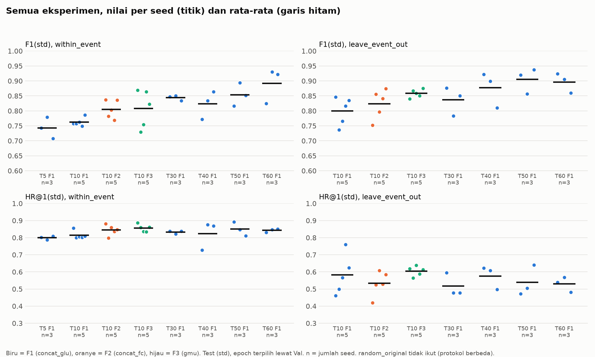

# Perbandingan Seluruh Eksperimen, per Seed

| | |
|---|---|
| Tanggal | 23 November 2026 |
| Data | Train Ticket (TT), `A1`, jendela T = 5, 10, 30, 40, 50, 60 detik |
| Eksperimen | 16 kelompok, 60 run: sweep T (F1), perbandingan fusion F1, F2, F3 (GMU) di T = 10, dan `random_original` |
| Pengaturan | 15 epoch, batch 256, lr 0,001, epoch dipilih lewat Val (`combo`), evaluasi tiap 5 epoch. `random_original`: 50 epoch, dipilih lewat HR@1 |
| Seed | 42, 7, 123 (semua), 31 dan 2026 (hanya T = 10, F1, F2, F3) |
| Metrik | Test, versi (std). Nilai pada epoch yang terpilih lewat Val |
| Rekap | `work/envs/train312/bin/python -I pipeline/rekap_semua.py --gambar` |
| Gambar | `Report/Gambar_Seed_Semua.png` |

Laporan ini menyatukan hasil dari `Temuan_Data_dan_Sweep_T.md`, `Laporan_Fusion_F1_vs_F2.md` (termasuk F3, bagian 10), `Laporan_Eksperimen_Seed.md`, dan `docs/F3_GMU.md`, dengan **nilai tiap seed ditampilkan** supaya terlihat seberapa besar sebaran yang disebabkan seed saja. Run uji awal (n = 1, 30 dan 50 epoch di T = 10) tidak diikutkan.

## Ringkasan

1. **Sebaran antar seed sering sama besar dengan selisih antar eksperimen.** Contoh `leave_event_out`, HR@1(std) T = 10 F1: lima seed berkisar 0,461 sampai 0,759. Selisih antar T atau antar fusion di skema ini umumnya lebih kecil dari rentang itu.
2. **Kualitas deteksi (F1(std)) naik bersama T**, dan kenaikan itu cukup jelas di beberapa titik: `within_event` T = 30 (+0,082) dan `leave_event_out` T = 50 (+0,105) serta T = 60 (+0,096), terhadap T = 10. Kenaikan itu datang dari Recall yang mendekati 1 (0,97–0,99) dan Precision yang ikut naik.
3. **Lokalisasi (HR@1(std)) tidak membaik dengan T besar.** Tidak ada satu pun selisih HR@1 terhadap T = 10 yang CI-nya lepas dari 0, di kedua skema.
4. **Fusion di T = 10 (F1, F2, F3):** F3 (GMU) setara atau sedikit lebih baik dari F1. Semua selisih rata-ratanya menguntungkan F3, tetapi hanya dua yang CI-nya tidak memuat 0, dan keduanya tipis: HR@1(std) `within_event` +0,042 (CI +0,008 s.d. +0,075) dan F1(std) `leave_event_out` +0,059 (CI +0,001 s.d. +0,116). F2 terhadap F1: hanya F1(std) `within_event` +0,043 (CI +0,005 s.d. +0,081). F3 terhadap F2: tidak ada selisih terbukti. F3 memakai 28% parameter lebih banyak dari F1.
5. **Hati-hati menafsirkan "terbukti".** Ada 26 selisih terhadap T = 10 F1 yang diuji tanpa koreksi, 7 di antaranya CI-nya tidak memuat 0. Tiga di antaranya tipis (batas bawah +0,001, +0,004, dan +0,005). Test set juga berbeda antar T. Baca sebagai petunjuk yang menguatkan arah, bukan bukti tiap angka.
6. **Jumlah seed tidak seimbang:** T = 10 punya 5 seed, T lain hanya 3. Karena itu CI di T lain lebar, dan selisih besar (misalnya T = 60 `within_event` +0,130) tetap belum terbukti.

---

## 1. Daftar eksperimen dan seed

| Kelompok | Skema | Seed | Jumlah run |
|---|---|---|---|
| T = 5, F1 | `within_event` | 42, 7, 123 | 3 |
| T = 10, F1 (`concat_glu`) | `within_event`, `leave_event_out` | 42, 7, 123, 31, 2026 | 10 |
| T = 10, F2 (`concat_fc`) | `within_event`, `leave_event_out` | 42, 7, 123, 31, 2026 | 10 |
| T = 10, F3 (`gmu`, GMU) | `within_event`, `leave_event_out` | 42, 7, 123, 31, 2026 | 10 |
| T = 30, 40, 50, 60, F1 | `within_event`, `leave_event_out` | 42, 7, 123 | 24 |
| T = 10, F1, 50 epoch | `random_original` | 42, 7, 123 | 3 |
| **Total** | | | **60** |

T = 5 hanya dijalankan di `within_event`. F3 = Gated Multimodal Unit (Arevalo dkk., 2017), lihat `docs/F3_GMU.md`. F4 belum ada.

## 2. Cara membaca

- Seed mengubah inisialisasi bobot dan urutan batch. Pembagian data tidak berubah (dibagi per event), dan Test tetap sama untuk semua seed pada satu T.
- Angka dalam kurung = epoch yang terpilih lewat Val untuk run itu. Epoch 4 berarti run yang Val-nya paling baik di awal.
- "Selisih" = rata-rata eksperimen − rata-rata baseline T = 10 F1 (skema yang sama). CI 95% memakai Welch. Selisih dianggap terbukti hanya bila CI tidak memuat 0 (dicetak **tebal**).
- Test berisi jumlah jendela yang berbeda untuk tiap T, sehingga selisih antar T tidak murni efek T saja.

## 3. Hasil

### 3.1 `within_event`

**F1(std) per seed** (epoch terpilih dalam kurung)

| Eksperimen | n | seed 42 | seed 7 | seed 123 | seed 31 | seed 2026 | rata-rata ± sd | min – maks |
|---|---|---|---|---|---|---|---|---|
| T=5 F1 | 3 | 0,708 (9) | 0,742 (4) | 0,779 (9) | – | – | 0,743 ± 0,036 | 0,708 – 0,779 |
| T=10 F1 | 5 | 0,786 (14) | 0,758 (14) | 0,757 (9) | 0,763 (14) | 0,749 (9) | 0,763 ± 0,014 | 0,749 – 0,786 |
| T=10 F2 | 5 | 0,782 (14) | 0,836 (9) | 0,837 (9) | 0,768 (14) | 0,803 (9) | 0,805 ± 0,031 | 0,768 – 0,837 |
| T=10 F3 | 5 | 0,864 (9) | 0,869 (9) | 0,729 (9) | 0,754 (9) | 0,822 (14) | 0,808 ± 0,064 | 0,729 – 0,869 |
| T=30 F1 | 3 | 0,847 (9) | 0,851 (4) | 0,834 (9) | – | – | 0,844 ± 0,009 | 0,834 – 0,851 |
| T=40 F1 | 3 | 0,772 (9) | 0,864 (9) | 0,833 (9) | – | – | 0,823 ± 0,047 | 0,772 – 0,864 |
| T=50 F1 | 3 | 0,817 (14) | 0,851 (14) | 0,894 (14) | – | – | 0,854 ± 0,039 | 0,817 – 0,894 |
| T=60 F1 | 3 | 0,930 (14) | 0,824 (14) | 0,922 (14) | – | – | 0,892 ± 0,059 | 0,824 – 0,930 |

**HR@1(std) per seed** (epoch terpilih dalam kurung)

| Eksperimen | n | seed 42 | seed 7 | seed 123 | seed 31 | seed 2026 | rata-rata ± sd | min – maks |
|---|---|---|---|---|---|---|---|---|
| T=5 F1 | 3 | 0,809 (9) | 0,801 (4) | 0,787 (9) | – | – | 0,799 ± 0,011 | 0,787 – 0,809 |
| T=10 F1 | 5 | 0,809 (14) | 0,857 (14) | 0,799 (9) | 0,805 (14) | 0,801 (9) | 0,814 ± 0,024 | 0,799 – 0,857 |
| T=10 F2 | 5 | 0,797 (14) | 0,848 (9) | 0,882 (9) | 0,837 (14) | 0,859 (9) | 0,844 ± 0,031 | 0,797 – 0,882 |
| T=10 F3 | 5 | 0,834 (9) | 0,887 (9) | 0,860 (9) | 0,835 (9) | 0,862 (14) | 0,856 ± 0,022 | 0,834 – 0,887 |
| T=30 F1 | 3 | 0,837 (9) | 0,821 (4) | 0,839 (9) | – | – | 0,832 ± 0,010 | 0,821 – 0,839 |
| T=40 F1 | 3 | 0,728 (9) | 0,869 (9) | 0,876 (9) | – | – | 0,824 ± 0,084 | 0,728 – 0,876 |
| T=50 F1 | 3 | 0,892 (14) | 0,811 (14) | 0,847 (14) | – | – | 0,850 ± 0,041 | 0,811 – 0,892 |
| T=60 F1 | 3 | 0,847 (14) | 0,830 (14) | 0,851 (14) | – | – | 0,842 ± 0,011 | 0,830 – 0,851 |

**Rata-rata ± sd, semua ukuran (Test, std)**

| Eksperimen | n | F1 | Pre | Rec | HR@1 | HR@3 | s/epoch |
|---|---|---|---|---|---|---|---|
| T=5 F1 | 3 | 0,743 ± 0,036 | 0,616 ± 0,062 | 0,942 ± 0,038 | 0,799 ± 0,011 | 0,878 ± 0,031 | 32 |
| T=10 F1 | 5 | 0,763 ± 0,014 | 0,655 ± 0,036 | 0,916 ± 0,032 | 0,814 ± 0,024 | 0,874 ± 0,021 | 51 |
| T=10 F2 | 5 | 0,805 ± 0,031 | 0,709 ± 0,047 | 0,935 ± 0,035 | 0,844 ± 0,031 | 0,896 ± 0,031 | 56 |
| T=10 F3 | 5 | 0,808 ± 0,064 | 0,704 ± 0,091 | 0,955 ± 0,019 | 0,856 ± 0,022 | 0,911 ± 0,023 | 53 |
| T=30 F1 | 3 | 0,844 ± 0,009 | 0,749 ± 0,013 | 0,968 ± 0,008 | 0,832 ± 0,010 | 0,915 ± 0,004 | 124 |
| T=40 F1 | 3 | 0,823 ± 0,047 | 0,732 ± 0,057 | 0,940 ± 0,039 | 0,824 ± 0,084 | 0,894 ± 0,057 | 168 |
| T=50 F1 | 3 | 0,854 ± 0,039 | 0,765 ± 0,067 | 0,970 ± 0,007 | 0,850 ± 0,041 | 0,922 ± 0,042 | 214 |
| T=60 F1 | 3 | 0,892 ± 0,059 | 0,814 ± 0,095 | 0,992 ± 0,001 | 0,842 ± 0,011 | 0,933 ± 0,011 | 260 |

**Selisih terhadap baseline T=10 F1** (rata-rata eksperimen − rata-rata baseline, CI 95% Welch; **tebal** = CI tidak memuat 0)

| Eksperimen | n | ΔF1(std) | CI 95% | ΔHR@1(std) | CI 95% |
|---|---|---|---|---|---|
| T=5 F1 | 3 | −0,020 | −0,099 s.d. +0,060 | −0,015 | −0,046 s.d. +0,016 |
| T=10 F2 | 5 | **+0,043** | +0,005 s.d. +0,081 | +0,030 | −0,011 s.d. +0,071 |
| T=10 F3 | 5 | +0,045 | −0,033 s.d. +0,123 | **+0,042** | +0,008 s.d. +0,075 |
| T=30 F1 | 3 | **+0,082** | +0,061 s.d. +0,102 | +0,018 | −0,012 s.d. +0,048 |
| T=40 F1 | 3 | +0,060 | −0,047 s.d. +0,168 | +0,010 | −0,185 s.d. +0,205 |
| T=50 F1 | 3 | **+0,091** | +0,004 s.d. +0,179 | +0,036 | −0,048 s.d. +0,120 |
| T=60 F1 | 3 | +0,130 | −0,011 s.d. +0,270 | +0,028 | −0,002 s.d. +0,059 |


### 3.2 `leave_event_out`

**F1(std) per seed** (epoch terpilih dalam kurung)

| Eksperimen | n | seed 42 | seed 7 | seed 123 | seed 31 | seed 2026 | rata-rata ± sd | min – maks |
|---|---|---|---|---|---|---|---|---|
| T=10 F1 | 5 | 0,766 (14) | 0,835 (14) | 0,816 (9) | 0,737 (14) | 0,846 (9) | 0,800 ± 0,047 | 0,737 – 0,846 |
| T=10 F2 | 5 | 0,752 (14) | 0,874 (14) | 0,855 (14) | 0,842 (14) | 0,797 (14) | 0,824 ± 0,049 | 0,752 – 0,874 |
| T=10 F3 | 5 | 0,851 (9) | 0,859 (14) | 0,841 (14) | 0,867 (9) | 0,875 (9) | 0,858 ± 0,014 | 0,841 – 0,875 |
| T=30 F1 | 3 | 0,783 (4) | 0,851 (14) | 0,876 (14) | – | – | 0,837 ± 0,048 | 0,783 – 0,876 |
| T=40 F1 | 3 | 0,899 (14) | 0,922 (4) | 0,810 (14) | – | – | 0,877 ± 0,059 | 0,810 – 0,922 |
| T=50 F1 | 3 | 0,857 (14) | 0,920 (9) | 0,938 (14) | – | – | 0,905 ± 0,042 | 0,857 – 0,938 |
| T=60 F1 | 3 | 0,860 (14) | 0,905 (4) | 0,924 (14) | – | – | 0,896 ± 0,033 | 0,860 – 0,924 |

**HR@1(std) per seed** (epoch terpilih dalam kurung)

| Eksperimen | n | seed 42 | seed 7 | seed 123 | seed 31 | seed 2026 | rata-rata ± sd | min – maks |
|---|---|---|---|---|---|---|---|---|
| T=10 F1 | 5 | 0,566 (14) | 0,624 (14) | 0,759 (9) | 0,498 (14) | 0,461 (9) | 0,582 ± 0,118 | 0,461 – 0,759 |
| T=10 F2 | 5 | 0,419 (14) | 0,584 (14) | 0,525 (14) | 0,528 (14) | 0,609 (14) | 0,533 ± 0,073 | 0,419 – 0,609 |
| T=10 F3 | 5 | 0,588 (9) | 0,638 (14) | 0,619 (14) | 0,564 (9) | 0,613 (9) | 0,605 ± 0,029 | 0,564 – 0,638 |
| T=30 F1 | 3 | 0,477 (4) | 0,478 (14) | 0,595 (14) | – | – | 0,517 ± 0,068 | 0,477 – 0,595 |
| T=40 F1 | 3 | 0,608 (14) | 0,622 (4) | 0,498 (14) | – | – | 0,576 ± 0,068 | 0,498 – 0,622 |
| T=50 F1 | 3 | 0,504 (14) | 0,472 (9) | 0,641 (14) | – | – | 0,539 ± 0,090 | 0,472 – 0,641 |
| T=60 F1 | 3 | 0,480 (14) | 0,568 (4) | 0,539 (14) | – | – | 0,529 ± 0,045 | 0,480 – 0,568 |

**Rata-rata ± sd, semua ukuran (Test, std)**

| Eksperimen | n | F1 | Pre | Rec | HR@1 | HR@3 | s/epoch |
|---|---|---|---|---|---|---|---|
| T=10 F1 | 5 | 0,800 ± 0,047 | 0,720 ± 0,054 | 0,903 ± 0,071 | 0,582 ± 0,118 | 0,699 ± 0,103 | 58 |
| T=10 F2 | 5 | 0,824 ± 0,049 | 0,763 ± 0,050 | 0,898 ± 0,072 | 0,533 ± 0,073 | 0,638 ± 0,088 | 58 |
| T=10 F3 | 5 | 0,858 ± 0,014 | 0,793 ± 0,027 | 0,937 ± 0,019 | 0,605 ± 0,029 | 0,738 ± 0,019 | 60 |
| T=30 F1 | 3 | 0,837 ± 0,048 | 0,766 ± 0,038 | 0,922 ± 0,066 | 0,517 ± 0,068 | 0,622 ± 0,052 | 142 |
| T=40 F1 | 3 | 0,877 ± 0,059 | 0,806 ± 0,070 | 0,962 ± 0,041 | 0,576 ± 0,068 | 0,695 ± 0,073 | 197 |
| T=50 F1 | 3 | 0,905 ± 0,042 | 0,839 ± 0,066 | 0,983 ± 0,009 | 0,539 ± 0,090 | 0,652 ± 0,054 | 254 |
| T=60 F1 | 3 | 0,896 ± 0,033 | 0,819 ± 0,056 | 0,992 ± 0,003 | 0,529 ± 0,045 | 0,680 ± 0,036 | 310 |

**Selisih terhadap baseline T=10 F1** (rata-rata eksperimen − rata-rata baseline, CI 95% Welch; **tebal** = CI tidak memuat 0)

| Eksperimen | n | ΔF1(std) | CI 95% | ΔHR@1(std) | CI 95% |
|---|---|---|---|---|---|
| T=10 F2 | 5 | +0,024 | −0,046 s.d. +0,094 | −0,049 | −0,197 s.d. +0,099 |
| T=10 F3 | 5 | **+0,059** | +0,001 s.d. +0,116 | +0,023 | −0,121 s.d. +0,167 |
| T=30 F1 | 3 | +0,037 | −0,058 s.d. +0,131 | −0,065 | −0,226 s.d. +0,095 |
| T=40 F1 | 3 | +0,077 | −0,040 s.d. +0,194 | −0,006 | −0,167 s.d. +0,155 |
| T=50 F1 | 3 | **+0,105** | +0,021 s.d. +0,189 | −0,043 | −0,229 s.d. +0,143 |
| T=60 F1 | 3 | **+0,096** | +0,026 s.d. +0,167 | −0,052 | −0,199 s.d. +0,094 |


### 3.3 `random_original` (protokol bocor, tidak sebanding)

**F1(std) per seed** (epoch terpilih dalam kurung)

| Eksperimen | n | seed 42 | seed 7 | seed 123 | seed 31 | seed 2026 | rata-rata ± sd | min – maks |
|---|---|---|---|---|---|---|---|---|
| T=10 F1 (50 ep, pilih HR@1) | 3 | 0,924 (9) | 0,913 (9) | 0,931 (19) | – | – | 0,923 ± 0,009 | 0,913 – 0,931 |

**HR@1(std) per seed** (epoch terpilih dalam kurung)

| Eksperimen | n | seed 42 | seed 7 | seed 123 | seed 31 | seed 2026 | rata-rata ± sd | min – maks |
|---|---|---|---|---|---|---|---|---|
| T=10 F1 (50 ep, pilih HR@1) | 3 | 0,975 (9) | 0,961 (9) | 0,989 (19) | – | – | 0,975 ± 0,014 | 0,961 – 0,989 |

**Rata-rata ± sd, semua ukuran (Test, std)**

| Eksperimen | n | F1 | Pre | Rec | HR@1 | HR@3 | s/epoch |
|---|---|---|---|---|---|---|---|
| T=10 F1 (50 ep) | 3 | 0,923 ± 0,009 | 0,873 ± 0,006 | 0,980 ± 0,012 | 0,975 ± 0,014 | 0,979 ± 0,012 | 75 |

## 4. Gambar



Titik = satu seed, garis hitam = rata-rata. Biru = F1, oranye = F2, hijau = F3 (GMU). Di panel `leave_event_out` HR@1, titik-titik satu eksperimen membentang lebih lebar daripada jarak antar eksperimen, kecuali F3 yang titiknya rapat (0,564–0,638).

## 5. Pembacaan

### 5.1 Seberapa besar sebaran seed

| Skema | Ukuran | sd terkecil | sd terbesar | Eksperimen sd terbesar |
|---|---|---|---|---|
| `within_event` | F1(std) | 0,009 (T = 30) | 0,064 (T = 10 F3) | T = 10 F3 (seed 123 = 0,729) |
| `within_event` | HR@1(std) | 0,010 (T = 30) | 0,084 (T = 40) | T = 40 (seed 42 = 0,728) |
| `leave_event_out` | F1(std) | 0,014 (T = 10 F3) | 0,059 (T = 40) | T = 40 |
| `leave_event_out` | HR@1(std) | 0,029 (T = 10 F3) | 0,118 (T = 10 F1) | T = 10 F1 |

`leave_event_out` cenderung lebih tidak stabil untuk lokalisasi daripada `within_event` (sd 0,029–0,118 melawan 0,010–0,084). Pengecualiannya F3: sd HR@1 `leave_event_out` hanya 0,029, terkecil dari semua eksperimen, tetapi perbedaan sebaran terhadap F1 belum terbukti (Levene p = 0,09), dan di `within_event` sebaran F1(std) F3 justru terbesar. Alasan yang masuk akal: Test `leave_event_out` terdiri dari event yang tidak ada di Train, dan hasilnya sensitif pada bagaimana model kebetulan tertata. Ini dugaan, belum diperiksa per event.

### 5.2 Pengaruh T pada deteksi (F1(std))

- `within_event`: rata-rata naik dari 0,743 (T = 5) ke 0,892 (T = 60) dengan satu penurunan di T = 40 (0,823). Terhadap T = 10: T = 30 terbukti (+0,082, CI +0,061 s.d. +0,102), T = 50 tipis (+0,091, CI +0,004 s.d. +0,179), T = 60 belum (+0,130, CI −0,011 s.d. +0,270 karena sd 0,059).
- `leave_event_out`: naik sampai T = 50 (0,905) lalu mendatar di T = 60 (0,896). T = 50 dan T = 60 terbukti terhadap T = 10 (+0,105 dan +0,096).
- Perhatikan bahwa T = 50 bisa tampak "terbukti" sedangkan T = 60 yang rata-ratanya lebih tinggi tidak. Itu karena lebar CI mengikuti sd tiap eksperimen, bukan karena T = 50 lebih baik. Jangan menyusun peringkat T dari ada-tidaknya tanda tebal.
- Kenaikan ini datang dari Recall (0,92 → 0,99 di T = 60) dan Precision (0,72 → 0,82 di `leave_event_out`). Alarm palsu tetap tinggi di T besar (lihat `Temuan_Data_dan_Sweep_T.md` bagian 16: FPR 0,47 ± 0,18 di T = 60 `leave_event_out`).

### 5.3 Pengaruh T pada lokalisasi (HR@1(std))

- `within_event`: hampir datar, 0,799–0,850, selisih terbesar terhadap T = 10 hanya +0,036. Tidak ada yang terbukti. T = 60 hampir (CI −0,002 s.d. +0,059).
- `leave_event_out`: 0,517–0,582, **tanpa tren** dan tanpa selisih terbukti. T = 10 paling tinggi secara rata-rata, tetapi dengan sd 0,118 itu tidak bisa dibedakan dari T lain.
- Artinya: kalau tujuannya menunjuk layanan penyebab, memperbesar T tidak menolong, sedangkan biaya latih per epoch di T = 60 sekitar 6× T = 10 (lihat `Temuan_Data_dan_Sweep_T.md` bagian 17).

### 5.4 F1 vs F2 vs F3 di T = 10

Rinciannya di `Laporan_Fusion_F1_vs_F2.md` bagian 9 (F1 vs F2) dan bagian 10 (F3), serta `docs/F3_GMU.md` bagian 13.

| Selisih (CI 95% Welch) | `within_event` F1(std) | `within_event` HR@1(std) | `leave_event_out` F1(std) | `leave_event_out` HR@1(std) |
|---|---|---|---|---|
| F2 − F1 | **+0,043** (+0,005 s.d. +0,081) | +0,030 | +0,024 | −0,049 |
| F3 − F1 | +0,045 (−0,033 s.d. +0,123) | **+0,042** (+0,008 s.d. +0,075) | **+0,059** (+0,001 s.d. +0,116) | +0,023 |
| F3 − F2 | +0,002 | +0,011 | +0,035 | +0,072 (−0,018 s.d. +0,161) |

- F3 unggul atas F1 di dua tempat, dan keduanya tipis. Di `within_event`, kenaikan HR@1 berasal dari Recall: HR@1 bersyarat (hanya gangguan yang terdeteksi) sama, 0,896 vs 0,890. Di `leave_event_out`, kenaikan F1(std) berasal dari Precision (+0,073), yaitu alarm palsu lebih sedikit (FPR 0,371 vs 0,535).
- F3 dan F2 tidak bisa dibedakan. Karena F3 punya 28% parameter lebih banyak dari F1 dan F2 punya 14% lebih sedikit, keunggulan F3 atas F1 belum bisa dikaitkan khusus pada gate per modalitas.

### 5.5 Pola per seed

Dengan tiga seed yang dipakai di semua eksperimen (42, 7, 123), peringkatnya tidak konsisten di `within_event`. Seed 42 rata-rata peringkat 2,25 dan 2,12 (harapan jika acak = 2,0) untuk F1(std) dan HR@1(std), dari 8 konfigurasi. Di `leave_event_out` ada petunjuk lemah: **seed 42 paling rendah di 5 dari 7 konfigurasi**, baik untuk F1(std) maupun HR@1(std) (rata-rata peringkat 2,71 untuk keduanya). Ini bisa kebetulan, karena hanya tiga seed dan ketujuh konfigurasi tidak saling bebas (T = 10 F1, F2, dan F3 memakai seed yang sama). Kalau memang ada efek seed yang menetap, perbandingan T seharusnya berpasangan per seed dan CI-nya akan lebih sempit. Itu belum dikerjakan.

### 5.6 Pilihan epoch

Epoch 4 terpilih di 5 run, semuanya di T ≠ 10: T = 5 seed 7, T = 30 `within_event` seed 7, T = 30 `leave_event_out` seed 42, T = 40 `leave_event_out` seed 7, dan T = 60 `leave_event_out` seed 7. Di T = 10 tidak pernah. Epoch 14 (terakhir) terpilih di banyak run T besar. Jadi pada T besar, kapan Val terbaik bervariasi lebar, dan 15 epoch mungkin belum cukup untuk membandingkan T secara adil (dugaan, belum diuji).

### 5.7 `random_original`

Hanya F1, T = 10, 3 seed: F1(std) 0,923 ± 0,009 dan HR@1(std) 0,975 ± 0,014. Sebaran seed sangat kecil. Protokol ini bocor (event yang sama muncul di Train dan Test), jadi hasilnya mendekati batas atas dan **tidak sebanding** dengan dua skema lainnya. Itu juga sebabnya sebarannya kecil.

## 6. Yang berubah dibanding laporan sebelumnya

Baseline T = 10 F1 sekarang berisi 5 seed (dulu 3), dan F3 (GMU, 5 seed) ditambahkan pada 23 November. Akibatnya CI selisih terhadap T = 10 berubah:

| Selisih terhadap T = 10 F1 | Dulu (n = 3) | Sekarang (n = 5) |
|---|---|---|
| `within_event` T = 30, F1(std) | +0,077 (CI +0,031 s.d. +0,123), terbukti | +0,082 (CI +0,061 s.d. +0,102), terbukti |
| `within_event` T = 50, F1(std) | belum terbukti | +0,091 (CI +0,004 s.d. +0,179), **tipis** |
| `leave_event_out` T = 50, F1(std) | belum terbukti | +0,105 (CI +0,021 s.d. +0,189), terbukti |
| `leave_event_out` T = 60, F1(std) | belum terbukti | +0,096 (CI +0,026 s.d. +0,167), terbukti |

Rata-rata selisihnya hampir tidak berubah. Yang berubah adalah CI: baseline T = 10 yang punya sd kecil (0,014 di `within_event`) dan n = 5 menyempitkan lebar CI. Itu sah, tetapi ini juga artinya status "belum terbukti" di laporan lama sebagian adalah akibat n kecil. Laporan lain (`Temuan_Data_dan_Sweep_T.md` bagian 13–16, `Ringkasan_Sweep_T_untuk_Dosen.md`) masih memakai CI n = 3 dan belum diperbarui.

## 7. Keterbatasan

1. **Jumlah seed tidak seimbang** (5 vs 3). CI di T selain 10 lebar, dan seed 31 dan 2026 belum ada di sana.
2. **Banyak perbandingan tanpa koreksi:** 26 selisih, 7 melewati batas. Bila semuanya nol sebenarnya, kira-kira 1–2 yang melewati batas karena kebetulan. Tiga yang tipis (T = 50 `within_event`, F2 `within_event`, dan F3 `leave_event_out` F1(std)) paling mungkin kebetulan.
3. **Test set berbeda antar T**, jadi selisih antar T tidak murni efek T.
4. **Seed hanya memengaruhi inisialisasi dan urutan batch.** Event Test tetap, sehingga sebaran ini tidak mencakup variasi akibat event yang dipilih.
5. **15 epoch untuk semua T**, dan 5 run memilih epoch 4. Pada T besar, 15 epoch mungkin tidak adil.
6. **Fusion hanya F1, F2, F3, dan hanya di T = 10.** F4 belum dikerjakan dan harus memakai kelima seed. Kapasitas antar fusion tidak sama (F2 −14%, F3 +28% parameter terhadap F1), sehingga selisih fusion bercampur dengan efek kapasitas.
7. **Tidak ada ablation modalitas dan tidak ada analisis per jenis gangguan.**

## 8. Yang boleh dan belum boleh diklaim

**Boleh:**
- Menambah T dari 10 ke 30 menaikkan F1(std) `within_event` (+0,082, CI tidak memuat 0).
- Di `leave_event_out`, T = 50 dan 60 menaikkan F1(std) sekitar 0,10 terhadap T = 10.
- Tidak ada bukti bahwa T besar memperbaiki lokalisasi (HR@1(std)) di skema mana pun.
- F1 dan F2 tidak bisa dibedakan secara meyakinkan di T = 10.
- F3 (GMU) setara atau sedikit lebih baik dari F1 di T = 10: semua selisih rata-rata searah menguntungkan F3, dua di antaranya dengan CI tidak memuat 0 (tipis).

**Belum boleh:**
- Menyebut satu T sebagai "terbaik". Selisih antar T besar (30–60) tidak terbukti.
- Menyebut F2 lebih baik dari F1 (hanya satu petunjuk tipis).
- Menyebut F3 "terbukti lebih baik", atau menyebut keunggulannya berasal dari gate per modalitas (efek kapasitas belum dipisahkan; terhadap F2 tidak ada selisih).
- Menyebut F3 lebih stabil antar seed (Levene p ≈ 0,09 di `leave_event_out`; di `within_event` justru lebih tersebar).
- Menyebut efek T murni, karena Test berbeda per T.
- Menyebut seed 42 "jelek" di `leave_event_out` (petunjuk lemah, n = 3).

## 9. Reproduksi

```bash
cd "/home/ojan/AI Labs/EADRO - APDM"
work/envs/train312/bin/python -I pipeline/rekap_semua.py --gambar > Report/tabel_semua_eksperimen.md   # opsional
work/envs/train312/bin/python -I pipeline/banding_fusion.py                                           # F1/F2/F3 lengkap (FPR, HR@1 bersyarat, uji permutasi)
```

Skrip membaca `work/result/*/params.json` dan `running.log`, mengambil Test pada epoch yang terpilih lewat Val, lalu menghitung rata-rata, sd (n−1), dan CI Welch. Kelompok dengan n < 2 dilewati.
