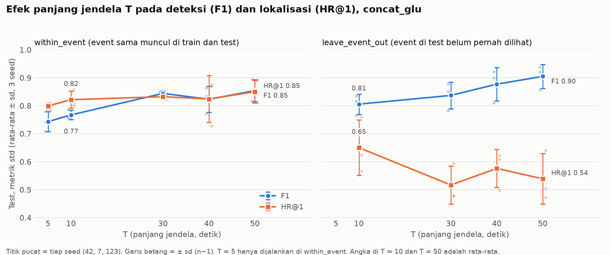
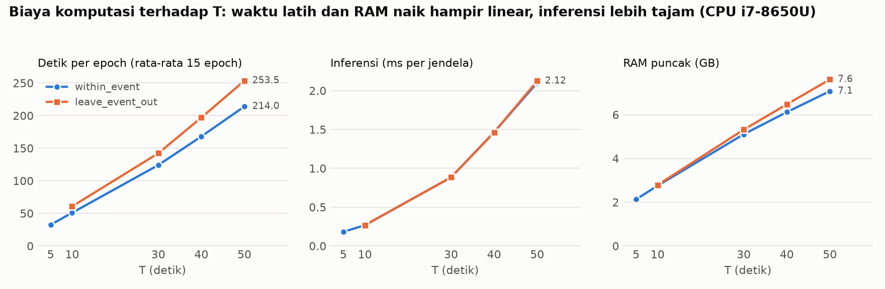

# Temuan Data Trace dan Rencana Eksplorasi Panjang Jendela (T)

| | |
|---|---|
| Dibuat | 10 November 2026, dini hari WIB |
| Diperbarui | 17 November 2026: hasil T = 30 (bagian 11), biaya terukur T = 30 (bagian 6). 21 November 2026: hasil T = 40 dan 50 `within_event` (bagian 12), hasil T = 30/40/50 `leave_event_out` (bagian 13), biaya terukur T = 40/50, perkiraan T = 60 direvisi (bagian 6), pertumbuhan parameter 130·T terverifikasi (bagian 7) |
| Cakupan | Dataset Train Ticket (TT) saja. Social Network (SN) di luar cakupan |
| Dokumen pendamping | `Report/Laporan_Eksperimen_Seed.md` (baseline 3 seed, T = 10) |
| Isi | Temuan tentang jumlah dan pola trace, cakupan jendela per T, saran dosen, biaya komputasi terukur per T, rencana sweep, dan pertanyaan yang belum diputuskan |

Bagian yang berisi **hasil terukur**, **perkiraan**, dan **dugaan yang belum diverifikasi** dipisahkan secara eksplisit. Skrip yang menghitung angka-angka di bagian 2–3 dulu disimpan di folder sementara sesi dan **tidak tersimpan di proyek**. Metodenya dijelaskan di tiap bagian sehingga bisa dihitung ulang.

---

## 1. Ringkasan

1. **Jumlah trace di data kita tidak jauh berbeda dari paper bila "trace" dihitung sebagai span.** Trace unik: 8.577. Span unik: 50.172. Paper melaporkan 48.296 trace TT. Selisih span dengan paper hanya 3,9%. Dugaan awal saya bahwa "data kita separuh paper" tidak didukung pengukuran dan sudah dicabut.
2. **Trace di data kita datang dalam lonjakan 1 detik tiap ±60 detik, bukan merata.** Ini berbeda dari deskripsi paper (0,2–0,5 permintaan per detik, merata). Pada T = 10 hanya ±18% jendela memuat satu pun span.
3. **Cakupan trace per jendela kira-kira sebanding dengan T/60.** Di antara nilai T yang dihitung (3, 5, 10, 20, 30, 60), hanya T = 60 yang hampir semua jendelanya (95%) memuat lonjakan. Itu menjadikan T = 60 titik penting dalam sweep.
4. **Biaya komputasi naik hampir linear terhadap T.** Dari pengukuran: T = 5 butuh ±30 menit untuk 3 seed, T = 50 butuh ±2 jam 54 menit (hanya training, `within_event`). Perkiraan T = 60 setelah T = 40 dan 50 terukur: build ±3,4 jam + training 3 seed ±3,5 jam, RAM puncak ±8–9 GB (sebelumnya ±9 jam dan ±10–11 GB). Perkiraan baru ini belum diukur (bagian 6).
5. **Saran dosen** (3 seed, T lebih kecil dan lebih besar) sudah mulai dijalankan: 3 seed selesai untuk T = 10 dan T = 5.
6. **Hasil T = 5 (bagian 10): tidak berbeda nyata dari T = 10** dengan 3 seed. Semua selisih kecil (F1 −0,024; HR@1 −0,023) dan semua selang kepercayaan selisih mencakup nol. Pembacaan dari seed 42 saja (Precision turun 0,14) tidak bertahan setelah 3 seed. T = 5 lebih ringan: 32 detik per epoch (T = 10: 51) dan RAM 2,1 GB (T = 10: 2,75 GB).
7. **Hasil T = 30 (bagian 11): deteksi membaik nyata, lokalisasi tidak.** F1 0,844 ± 0,009 vs 0,767 ± 0,017 (selisih +0,077, SK 95% +0,031 s.d. +0,123); alarm palsu Test turun dari ±62% ke ±47%. HR@1 hampir sama (0,832 vs 0,822). Hasil juga jauh lebih stabil antar seed. Biayanya: 124 detik per epoch (±2,4×), 0,88 ms per jendela (±3,3×), RAM 5,1 GB.
8. **Hasil T = 40 dan 50, `within_event` (bagian 12): keuntungan berhenti di sekitar T = 30.** F1 0,823 ± 0,047 (T = 40) dan 0,854 ± 0,039 (T = 50), HR@1 0,824 dan 0,850. Tidak ada yang lebih baik dari T = 30 (0,844 dan 0,832), dan selisih terhadap T = 10 tidak signifikan (SK 95% mencakup nol). Sebaran antar seed justru membesar (sd F1 0,009 pada T = 30 menjadi 0,047 dan 0,039). Pada T = 50 ketiga seed memilih epoch 14, yaitu epoch evaluasi terakhir.
9. **Hasil `leave_event_out` T = 30/40/50 (bagian 13): deteksi cenderung naik, lokalisasi tidak.** F1 naik 0,806 → 0,837 → 0,877 → 0,905 (T = 10/30/40/50), alarm palsu Test turun 0,59 → 0,38. HR@1 justru di bawah T = 10 pada semua T besar (0,650 vs 0,517/0,576/0,539). **Tidak satu pun selisih terhadap T = 10 signifikan** (semua SK 95% mencakup nol, n = 3). Yang bisa dikatakan hanya arah: F1 naik terus, HR@1 tidak membaik.
10. **Pertumbuhan parameter 130·T terverifikasi**: kode dan lima titik terukur (T = 5, 10, 30, 40, 50) cocok persis (bagian 7).

---

## 2. Temuan jumlah trace

### 2.1 Pertanyaan

Dalam paper, TT dilaporkan memiliki 162 injeksi dan 48.296 trace. Data publik TT yang kita punya berisi 81 injeksi (9 run berfault × 9 injeksi, tiap pasangan service dan jenis fault satu kali) dan 3 run tanpa fault. Apakah selisih performa dengan paper sebagian berasal dari jumlah data yang lebih sedikit?

### 2.2 Hasil pengukuran

Cara hitung: trace dan span dihitung per ID unik di dalam rentang waktu 12 run (9 berfault + 3 tanpa fault).

| Ukuran | Nilai |
|---|---|
| Trace unik di dalam jendela 12 run | **8.577** |
| ... dari 9 run berfault | 5.751 |
| ... dari 3 run tanpa fault | 942 per run (2.826 total) |
| Trace unik tanpa filter jendela | 9.320 |
| Span unik di dalam jendela | **50.172** (client 20.804; server 29.363) |
| Laju trace | ±0,104 trace per detik |
| Paper (TT) | 48.296 "trace"; laju 0,2–0,5 permintaan per detik |

Catatan: jumlah client dan server (50.167) berbeda 5 dari total span (50.172). Selisih kecil itu tidak saya telusuri.

### 2.3 Pembacaan

- Jika "trace" diartikan sebagai trace unik, data kita **5,6 kali lebih sedikit** dari paper.
- Jika diartikan sebagai **span**, selisihnya hanya **3,9%** (50.172 vs 48.296).
- Paper tidak menjelaskan satuan hitungnya, jadi **belum pasti** mana yang tepat. Yang bisa dikatakan: ukuran data bukan penjelasan yang jelas atas selisih performa.

### 2.4 Hal yang belum dipastikan

Ketiga run tanpa fault memiliki jumlah **identik**: 942 trace, 5.522 span, 2.290 client. ID-nya berbeda. Konsisten dengan beban kerja yang deterministik (bagian 3), tetapi belum diperiksa apakah itu murni beban kerja otomatis atau data yang tersalin.

---

## 3. Temuan pola waktu trace: lonjakan tiap ±60 detik

### 3.1 Pengamatan (terverifikasi pada 12 run)

| Ukuran | Nilai |
|---|---|
| Median jeda antar lonjakan | **60 detik** (sama di 12 dari 12 run) |
| Median lebar lonjakan | 1 detik |
| Detik yang memuat span client | hanya 89–202 dari ±6.461 detik per run |
| Run tanpa fault | 135 lonjakan × ±7 trace = 942 trace |

Angka 135 × ±7 menjelaskan mengapa jumlah trace di tiga run tanpa fault identik. Penjelasan ini konsisten dengan data, tapi belum dibuktikan secara langsung.

Ini **berbeda dari deskripsi paper**, yang menyebut beban kerja merata (0,2–0,5 permintaan per detik). Di data kita, beban kerja berupa kiriman serempak sekali per menit.

### 3.2 Konsekuensi untuk model

Fitur trace per service adalah deret waktu latensi rata-rata per slot 1 detik. Karena lonjakan hanya 1 detik tiap 60 detik:

- Tiap deret service **±98,5% berisi nol**. Pada T = 10 rata-rata hanya 0,15 slot dari 10 yang terisi; pada T = 60 rata-rata 0,93 slot dari 60.
- Melebarkan slot (mis. 5 detik per slot) **tidak menambah kepadatan**, karena lonjakan itu sendiri hanya 1 detik lebarnya.
- Hanya 9 service (27 dari 81 fault) yang biangnya punya trace sama sekali. Untuk 54 fault lain, modalitas trace pada service biang selalu kosong.

Konsekuensinya: probabilitas sebuah jendela memuat setidaknya satu lonjakan ≈ **T / 60**.

---

## 4. Cakupan jendela per T

Jendela berstride 1 (jendela bergeser 1 detik). Persentase jendela yang memuat setidaknya satu span:

| T (detik) | 3 | 5 | 10 | 20 | 30 | 60 |
|---|---|---|---|---|---|---|
| Pada setidaknya satu service | 6,0% | 9,6% | **18,3%** | 34,5% | 49,9% | **95,3%** |
| Pada satu service ber-trace (9 service) | 4,6% | 7,6% | 15,1% | 30,0% | 44,9% | 89,4% |

### Komposisi label (threshold 1 detik tumpang tindih)

| T | Jendela gangguan | Normal di celah antar fault | Normal di run tanpa fault |
|---|---|---|---|
| 10 | 49.355 | 8.713 | 24.294 |
| 60 | 52.955 | 4.663 (turun 46%) | 24.144 |

Aturan labelnya: jendela diberi label "gangguan" bila ada tumpang tindih 1 detik saja dengan fault. Dengan T yang lebih besar, makin banyak jendela perbatasan yang berlabel gangguan, dan jendela normal di celah makin sedikit.

### Implikasi yang perlu dicatat

1. **Jendela normal di celah adalah sumber utama alarm palsu** (bagian 6.2 laporan seed). Jumlahnya berubah menurut T, sehingga komposisi kelas dan metrik per jenis normal sebaiknya dilaporkan bersama hasil tiap T.
2. **Jendela yang melintasi batas train/val/test dibuang.** Jumlah yang dibuang berubah menurut T: pada `within_event` 960 (T = 5), 2.160 (T = 10), dan 6.960 (T = 30).
3. **Jendela bertetangga makin mirip pada T besar.** Pada T = 60 dua jendela berurutan bertumpuk 59 dari 60 detik, sehingga sampel makin tidak independen.

### Hipotesis yang bisa diuji (bukan hasil)

Modalitas trace hanya memberi sinyal bila jendelanya cukup panjang menangkap lonjakan. Jadi bila hipotesis benar, T lebih besar seharusnya membantu lokalisasi dan deteksi. T = 5 sudah dijalankan (bagian 10) dan tidak berbeda nyata dari T = 10, jadi hasilnya belum mendukung maupun menolak hipotesis ini. **Pembaruan 17 Nov:** T = 30 (bagian 11) memperbaiki deteksi secara nyata tetapi tidak HR@1. Arahnya konsisten dengan hipotesis untuk deteksi, tetapi belum memisahkan efek trace dari efek metrik dan log yang lebih panjang. Itu butuh ablasi modalitas.

---

## 5. Saran dosen dan rencana

### 5.1 Saran dosen (10 November 2026)

1. Gunakan **3 seed berbeda**.
2. Eksplorasi **windowing yang lebih sedikit dan lebih banyak**.

### 5.2 Status eksekusi

| Saran | Status |
|---|---|
| 3 seed pada T = 10 (kedua skema) | **Selesai** (10 Nov, 00.38–02.13). Lihat `Laporan_Eksperimen_Seed.md` |
| T = 5, skema `within_event`, 3 seed | **Selesai** (10 Nov, 04.11–04.41). Hasil di bagian 10 |
| T = 30, skema `within_event`, 3 seed | **Selesai** (17 Nov, 01.28–05.05). Hasil di bagian 11 |
| T = 40 dan 50, skema `within_event`, 3 seed | **Selesai** (20 Nov 22.18 – 21 Nov 08.52, 10 jam 34 menit untuk build dua T + 6 run). Hasil di bagian 12 |
| T = 30, 40, 50, skema `leave_event_out`, 3 seed | **Selesai** (21 Nov 12.26 – 20.23, 7 jam 56 menit untuk 9 run + merakit chunk T = 30). Hasil di bagian 13 |
| T = 60 | Belum dijalankan. Perkiraan RAM direvisi turun (±8–9 GB, bagian 6.5), sehingga stride mungkin tidak perlu, tetapi tetap perlu keputusan (bagian 6.6) |

### 5.3 Desain yang dijalankan

- Hanya T yang berubah. Seluruh pengaturan lain sama dengan baseline T = 10: 15 epoch, `combo`, `eval_every = 5`, seed 42/7/123, `concat_glu`, `lr = 0,001`, batch 256.
- Skema `within_event` dulu, karena lebih murah dan variasinya antar seed lebih kecil (sd HR@1 ≈ 0,03 dibanding 0,10 di `leave_event_out`). Skema `leave_event_out` hanya perlu dijalankan untuk T yang efeknya melebihi sd.
- Setiap T dibangun dan dilatih **terpisah** sebagai dataset sendiri (`A1_T<T>`), sehingga data T = 10 tidak tertimpa dan urutan pengerjaan bebas.

### 5.4 Cara menjalankan satu T

```bash
cd "/home/ojan/AI Labs/EADRO - APDM"
nohup systemd-inhibit --what=sleep:idle --who="EADRO T5" bash -c '
  pipeline/build_T.sh 5 within_event &&
  DATA_NAME=A1_T5 pipeline/run_grid.sh within_event 15 "42 7 123" "concat_glu"
' > train_T5.out 2>&1 &
```

Ganti `5` dan `A1_T5` dengan T yang diinginkan. Hasil per T muncul sebagai grup `A1_T<T>/within_event` pada `python3 -I pipeline/rekap_seed.py work/result`.

---

## 6. Biaya komputasi per T

### 6.1 Waktu satu langkah latih (benchmark, data acak)

Benchmark mikro (±1 menit): forward, backward, dan Adam pada batch 256, 4 thread CPU, tanpa menyimpan apa pun.

| T | Detik per langkah | Tensor per jendela |
|---|---|---|
| 5 | 0,208 | 10,5 KB |
| 10 | 0,348 | 14,8 KB |
| 30 | 1,097 | 31,6 KB |
| 60 | 2,281 | 57,0 KB |

Kalibrasi: untuk T = 10 benchmark memprediksi 55 detik per epoch, sedangkan run nyata 51 detik.

### 6.2 Waktu per run dan per sweep

| T | Detik per epoch | Waktu per run (15 epoch + evaluasi) | 3 seed `within_event` | Sumber |
|---|---|---|---|---|
| 5 | 32 | 10 menit | ±30 menit | **Terukur** |
| 10 | 51 | 15 menit | ±45 menit | **Terukur** |
| 30 | 124 (perkiraan awal ±160) | ±33 menit | ±1,7 jam | **Terukur** (17 Nov) |
| 40 | 168,0 | 45 menit | 2 jam 16 menit | **Terukur** (21 Nov) |
| 50 | 214,0 | 57–59 menit | 2 jam 54 menit | **Terukur** (21 Nov) |
| 60 | ±259 (ekstrapolasi dari T = 30–50, +4,5 detik per T) | ±70 menit | ±3,5 jam | Perkiraan. Perkiraan lama dari benchmark (±340 detik per epoch, ±4,9 jam) terlalu tinggi |

Waktu per epoch di tabel adalah rata-rata 15 epoch, skema `within_event`. Skema `leave_event_out` lebih lama (lebih banyak jendela latih): T = 10 ±60,7 detik (+19%), T = 30 142,2 (+15%), T = 40 196,9 (+17%), T = 50 253,5 (+18%). Waktu per run `leave_event_out`: T = 30 37–38 menit, T = 40 51–54 menit, T = 50 67–69 menit. Satu run T = 10 `leave_event_out` (seed 42) memakan 30 menit, dua kali lipat dua seed lainnya (16 menit); sebabnya tidak diselidiki.

### 6.3 Biaya membangun data (cache)

Fitur log (Hawkes) memakan sebagian besar waktu build.

| T | Tahap `logs` per run | Total build 12 run (4 paralel) | Sumber |
|---|---|---|---|
| 5 | 205–399 detik | **23 menit** (03.47–04.11) | **Terukur** |
| 10 | 15–37 menit (8 proses serentak di 4 core; run tanpa fault paling lama) | ±47 menit (20.53–21.39) | Dari cap waktu berkas cache, bukan log |
| 30 | | **1 jam 57 menit** (01.28–03.25; perkiraan awal ±2,2 jam) | **Terukur** |
| 40 | | **2 jam 27 menit** (20 Nov 22.18 – 21 Nov 00.46, termasuk merakit chunk kedua skema) | **Terukur** |
| 50 | | **2 jam 56 menit** (03.02–05.58, termasuk merakit chunk kedua skema) | **Terukur** |
| 60 | | ±3,4 jam (ekstrapolasi dari T = 30–50, ±+29 menit per +10 T) | Perkiraan. Perkiraan lama ±4,4 jam terlalu tinggi |

Titik terukur 23 → ±47 → 117 → 147 → 176 menit untuk T = 5/10/30/40/50 hampir linear, jadi asumsi linear lolos uji untuk T ≤ 50. Sejak T = 40 build merakit chunk `within_event` dan `leave_event_out` sekaligus, sehingga satu build cukup untuk kedua skema.

Run tanpa fault (idx 9–11) berisi 8.102 jendela, lebih banyak daripada run berfault (6.456 jendela pada T = 5), dan selesai belakangan.

### 6.4 Total per T (build + 3 seed `within_event`)

| T | Total |
|---|---|
| 5 | ±55 menit (terukur) |
| 30 | **±3,6 jam (terukur)**; perkiraan awal ±4,6 jam |
| 40 | **±4 jam 44 menit (terukur)**: build 2 jam 27 menit + 3 seed `within_event` 2 jam 16 menit |
| 50 | **±5 jam 50 menit (terukur)**: build 2 jam 56 menit + 3 seed `within_event` 2 jam 54 menit |
| 60 | ±7 jam (perkiraan; perkiraan lama ±9,3 jam) |

Tambahan untuk `leave_event_out` (chunk sudah ada, hanya training 3 seed): T = 30 ±1 jam 54 menit, T = 40 ±2 jam 37 menit, T = 50 ±3 jam 25 menit.

### 6.5 RAM

- Mesin: Linux, Intel i7-8650U (4 core fisik, 8 thread), RAM 15 GB (±10–11 GB bebas), tanpa GPU.
- Peak RSS terukur: T = 5 → 2.131 MB; T = 10 → 2.752 MB.
- T = 30 diperkirakan ±5–6 GB; **terukur 5.105 MB** (17 Nov). Aman bila Chrome ditutup selama run.
- Peak RSS terukur (MB):

  | T | `within_event` | `leave_event_out` |
  |---|---|---|
  | 5 | 2.132 | |
  | 10 | 2.752 | 2.788 |
  | 30 | 5.105 | 5.316 |
  | 40 | 6.116 | 6.471 |
  | 50 | 7.074 | 7.609 |

  Naiknya ±1 GB per +10 T pada rentang 30–50.
- **Perkiraan T = 60 direvisi turun.** Perkiraan lama (tensor 57 KB × ±80 ribu jendela + salinan, ±10–11 GB) terlalu tinggi. Ekstrapolasi dari titik terukur: ±8,1 GB (`within_event`) dan ±8,7 GB (`leave_event_out`). RAM tersedia saat sweep ±10 GB (total 15 GB), jadi muat, tetapi dengan margin ±1–2 GB. Ini perkiraan yang belum diukur; aplikasi berat (browser) tetap perlu ditutup.

### 6.6 Opsi untuk T = 60

- **Tanpa stride** (stride 1, sama dengan T lain): dengan perkiraan RAM baru (±8–9 GB) ini kini layak dan menjaga perbandingan antar T tetap adil. Risiko: margin RAM sempit, dan satu run memakan ±70 menit.
- **Stride lebih besar** (mis. 5): memangkas waktu dan RAM sekitar 5×, tetapi mengubah jumlah sampel latih. Stride saat ini keras 1 di pembuat jendela, jadi perlu perubahan kode, dan perubahan itu harus dicatat sebagai perbedaan desain (hasil T = 60 tidak lagi sebanding langsung dengan T lain).
- **Satu seed untuk penyaringan** terlebih dahulu.
- **Dilewati**, dan T = 30 dipakai sebagai batas atas.

---

## 7. Yang berubah selain T

T bukan satu-satunya yang berubah bila T diganti. Perlu dicatat di laporan hasil sweep:

1. **Jumlah parameter model.** T = 5: 65.400; T = 10: 66.050; T = 30: 68.650; T = 40: 69.950; T = 50: 71.250. Semuanya cocok persis dengan **64.750 + 130·T** (selisih T = 10 → 50 adalah 5.200 = 130 × 40). **Terverifikasi di kode:** lapisan SelfAttention pada cabang trace dan cabang metrik punya bobot per posisi waktu (`atten_w` berukuran (T, 64, 1) dan `atten_bias` berukuran (T, 1, 1)), dua lapisan, sehingga 2 × (64 + 1) = 130 parameter per langkah waktu. Bagian fusion (18.560) tidak bergantung pada T. Konsekuensinya: model dengan T berbeda memang berbeda sedikit kapasitasnya (T = 50 hanya ±8% lebih besar daripada T = 10), dan model T = 10 tidak bisa dipakai langsung untuk T lain.
2. **Jumlah jendela yang dibuang** (purge) pada tiap batas split.
3. **Komposisi label**, terutama jendela normal di celah (bagian 4).
4. **Kelas normal berasal dari dua sumber:** celah antar fault dan run tanpa fault. Proporsinya berubah menurut T.

---

## 8. Pertanyaan yang belum diputuskan

| # | Pertanyaan | Catatan |
|---|---|---|
| 1 | Apa definisi sukses baseline: baseline jujur dengan selisih yang dijelaskan, atau mencocokkan angka paper? | Belum dijawab. Ini menentukan seberapa jauh protokol dilonggarkan |
| 2 | Apakah tingkat A dijalankan (protokol acak dari kode asli, sebagai batas atas diagnostik)? | Hanya diagnostik, bukan baseline. Protokol itu bocor waktu |
| 3 | Apakah run tanpa fault tetap menjadi kelas normal? | Mempengaruhi alarm palsu |
| 4 | Himpunan T akhir: {5, 10, 30} atau ditambah 40/50/60? | **Diperbarui (21 Nov):** T = 40 dan 50 sudah dijalankan; dosen meminta T = 40/50/60, jadi tinggal T = 60 (RAM ±8–9 GB, mungkin tanpa stride, bagian 6.6) |
| 5 | Berapa seed untuk seluruh sweep: 3 atau lebih? | Dengan sd HR@1 ≈ 0,10 di `leave_event_out`, 3 seed tidak cukup untuk selisih kecil |
| 6 | Skema mana yang dipakai untuk perbandingan fusion nanti? | Usulan awal: `within_event`. **Diganti (16 Nov):** usulan sekarang `leave_event_out`, karena F1 vs F2 hanya berbeda arah di skema itu (`Laporan_Fusion_F1_vs_F2.md`) |
| 7 | T mana yang dipakai untuk perbandingan fusion? | **Diperbarui (21 Nov), `leave_event_out` sudah dicek (bagian 13):** deteksi cenderung membaik dengan T, lokalisasi tidak (HR@1 terbaik di T = 10), dan tidak ada selisih yang signifikan dengan 3 seed. Biaya naik tajam (T = 50: ±4,2× waktu per epoch). Belum diputuskan. Opsi: T = 10 sebagai utama dan T = 30 atau 50 sebagai pembanding (bagian 13.7) |

Tiga tingkat protokol yang pernah diusulkan:

- **A:** protokol acak dari kode asli (hanya diagnostik batas atas).
- **B:** pembagian waktu 60/40 per periode (mirip `within_event`).
- **C:** `leave_event_out` (baseline untuk perbandingan fusion).

---

## 9. Masalah terbuka lain yang tercatat

1. **Slide 11 PPT lawan kode.** Slide itu menyebut empat kandidat fusion (F1–F4, termasuk Cross-Attention), sedangkan kode punya lima (`concat_glu`, `concat_fc`, `sum`, `attn`, `lmf`) dan Cross-Attention belum ada di kode.
2. **Ablasi modalitas** (pola Tabel IV paper: tanpa log/metrik/trace/graf) belum dilatih ulang. Paper TT melaporkan HR@1 menurun ke 0,926 (tanpa log), 0,776 (tanpa metrik), 0,785 (tanpa trace), 0,803 (tanpa graf). Diagnosis yang lebih awal pada run lama menunjukkan modalitas log tidak berpengaruh saat inferensi.
3. **Normalisasi per run** (z-score) adalah faktor pengganggu yang diketahui. Ablasi terkontrol belum dilakukan.
4. **Epoch.** Epoch terpilih sering yang terakhir; 15 epoch mungkin terlalu pendek. **Diperkuat (21 Nov):** pada T = 50 `within_event` ketiga seed memilih epoch 14, dan di `leave_event_out` T = 30/40/50 enam dari sembilan run memilih epoch 14 (bagian 12.5 dan 13.6). Karena evaluasi hanya di epoch 4/9/14, epoch 14 adalah batas atas yang bisa dipilih, jadi kurva validasi mungkin masih naik. Belum diuji dengan epoch lebih panjang.
5. **Portabilitas.** `peak_rss_mb` di `main.py` memakai `ru_maxrss/1024` (benar untuk Linux, salah untuk macOS), dan `run_train.sh` memakai `systemd-inhibit` (Linux saja). Bila training dipindah ke MacBook, kedua hal ini perlu disesuaikan, dan hasil dari platform berbeda tidak boleh dicampur dalam satu tabel.

---

## 10. Hasil T = 5 (skema `within_event`, 3 seed)

### 10.1 Pengaturan dan data

Semua pengaturan sama dengan baseline T = 10 (bagian 5.3); hanya T yang berubah. Data: `work/chunks/A1_T5/within_event`, `chunk_lenth = 5`.

| Bagian | T = 5 | T = 10 |
|---|---|---|
| Train | 40.930 (gangguan 24.868; normal 16.062) | 40.510 (24.823; 15.687) |
| Val | 7.910 (gangguan 5.489; normal 2.421) | 7.490 (5.084; 2.406) |
| Test | 32.610 (gangguan 17.990; normal 14.620) | 32.190 (17.990; 14.200) |
| Porsi normal di Test | 44,8% | 44,1% |
| Jendela dibuang (purge) | 960 | 2.160 |

Run:

| Seed | Hash | Epoch terpilih (`combo`) | Lama |
|---|---|---|---|
| 42 | `ee187163` | 9 | 10 mnt 04 dtk |
| 7 | `8b0b0528` | 4 | 9 mnt 40 dtk |
| 123 | `b8c0ba13` | 9 | 10 mnt 10 dtk |

Efisiensi: 65.400 parameter (T = 10: 66.050); 32 detik per epoch (T = 10: 51); ±0,18 ms per jendela (T = 10: 0,27); RAM puncak 2.132 MB (T = 10: 2.752 MB).

### 10.2 Per seed (Test, std, epoch terpilih)

| Metrik | Seed 42 | Seed 7 | Seed 123 |
|---|---|---|---|
| F1 | 0,708 | 0,742 | 0,779 |
| Recall | 0,946 | 0,979 | 0,903 |
| Precision | 0,566 | 0,598 | 0,685 |
| HR@1 | 0,809 | 0,801 | 0,787 |
| HR@3 | 0,882 | 0,906 | 0,845 |
| HR@5 | 0,908 | 0,924 | 0,872 |
| NDCG@3 | 0,852 | 0,863 | 0,822 |
| NDCG@5 | 0,862 | 0,871 | 0,833 |

### 10.3 Rata-rata ± sd, dibandingkan dengan T = 10

sd memakai pembagi n−1. Selang kepercayaan (SK) selisih memakai galat baku Welch dan t dengan 2 derajat kebebasan (4,303), yaitu pilihan konservatif. "|selisih|/galat" di bawah 2 kira-kira berarti selisih belum bisa dibedakan dari variasi antar seed.

| Metrik (std) | T = 5 (n = 3) | T = 10 (n = 3) | Selisih (5 − 10) | SK 95% selisih | \|selisih\| / galat |
|---|---|---|---|---|---|
| F1 | 0,743 ± 0,036 | 0,767 ± 0,017 | −0,024 | −0,121 s.d. +0,073 | 1,06 |
| Recall | 0,943 ± 0,038 | 0,923 ± 0,037 | +0,019 | −0,112 s.d. +0,151 | 0,63 |
| Precision | 0,616 ± 0,062 | 0,658 ± 0,045 | −0,042 | −0,231 s.d. +0,148 | 0,95 |
| HR@1 | 0,799 ± 0,011 | 0,822 ± 0,031 | −0,023 | −0,105 s.d. +0,059 | 1,19 |
| HR@3 | 0,878 ± 0,031 | 0,883 ± 0,024 | −0,005 | −0,103 s.d. +0,092 | 0,23 |
| HR@5 | 0,901 ± 0,027 | 0,896 ± 0,027 | +0,005 | −0,088 s.d. +0,098 | 0,25 |
| NDCG@3 | 0,846 ± 0,022 | 0,858 ± 0,027 | −0,012 | −0,097 s.d. +0,073 | 0,62 |
| NDCG@5 | 0,855 ± 0,020 | 0,863 ± 0,027 | −0,008 | −0,091 s.d. +0,075 | 0,42 |

Dibandingkan paper (F1 0,989; HR@1 0,990), T = 5 juga jauh di bawahnya, sama seperti T = 10.

Metrik asli kode, rata-rata ± sd (T = 5): F1 0,777 ± 0,055; HR@1 0,667 ± 0,094; HR@3 0,734 ± 0,113; HR@5 0,753 ± 0,113.

### 10.4 Alarm palsu (turunan, bukan dicatat kode)

Dihitung seperti di laporan seed, dari Recall, Precision, dan jumlah jendela, pada epoch terpilih.

| | Seed 42 | Seed 7 | Seed 123 | Rata-rata ± sd |
|---|---|---|---|---|
| T = 5, Val | 0,18 | 0,28 | 0,04 | 0,17 ± 0,13 |
| T = 5, **Test** | 0,89 | 0,81 | 0,51 | **0,74 ± 0,20** |
| T = 10, Test (dari laporan seed) | 0,46 | 0,70 | 0,69 | 0,62 ± 0,14 |

- Pada T = 5, ±74% jendela normal di Test diberi alarm, dibanding ±62% pada T = 10. Selisihnya kecil terhadap sd yang besar (0,20 dan 0,14), jadi tidak dapat disimpulkan berbeda.
- **Val tetap jauh lebih optimistis daripada Test** (alarm palsu 0,17 vs 0,74), sama dengan temuan di baseline T = 10.

### 10.5 Pemilihan epoch

- `combo` memilih epoch 9, 4, dan 9. Epoch 14 tidak pernah dipilih pada T = 5 (di T = 10: 14, 14, 9).
- Seed 7: Val `combo` turun dari 0,924 (epoch 4) ke 0,918 (epoch 9) dan 0,896 (epoch 14), padahal Precision Val naik hampir sempurna (0,887 → 0,995 → 0,994; alarm palsu Val turun ke ≈1%). Penurunan `combo` berasal dari Recall dan HR@1 Val yang turun. Karena Test tidak dihitung di epoch 9 dan 14, **tidak diketahui** apakah Test ikut membaik pada alarm palsunya.
- Seed 42 dan 123: pada epoch 4 yang tidak terpilih, Test HR@1 lebih rendah (0,703 dan 0,766) daripada epoch terpilih (0,809 dan 0,787). Pada dua seed ini pemilihan oleh Val tepat untuk lokalisasi.

### 10.6 Kesimpulan dan koreksi

1. **T = 5 dan T = 10 tidak dapat dibedakan dengan 3 seed.** Tidak ada metrik dengan |selisih|/galat di atas 1,2, dan semua SK selisih mencakup nol. Selisih dengan SK sempit sekalipun (±0,1) tidak dapat dikesampingkan.
2. **Arah selisih konsisten tetapi kecil:** F1 −0,024, Precision −0,042, HR@1 −0,023, Recall +0,019. Semuanya dalam rentang variasi antar seed.
3. **Koreksi atas pembacaan awal.** Setelah seed 42 saja, selisih Precision tampak −0,144 terhadap T = 10 seed 42, dan alarm palsu 0,89 tampak jauh lebih tinggi. Setelah 3 seed, selisih rata-rata Precision hanya −0,042 dan rentang Precision T = 5 (0,566–0,685) bertumpang tindih dengan T = 10 (0,632–0,710). Pembacaan satu seed itu tidak bertahan.
4. **Variasi antar seed sedikit berbeda:** sd Precision dan F1 pada T = 5 lebih besar (0,062 dan 0,036 vs 0,045 dan 0,017), sedangkan sd HR@1 lebih kecil (0,011 vs 0,031). Dengan 3 seed, perbedaan sd ini pun tidak pasti.
5. **T = 5 jauh lebih murah** tanpa kehilangan kualitas yang terlihat: waktu per epoch turun ±37% dan RAM ±23%. Ini satu-satunya perbedaan yang jelas.
6. **Hubungan dengan hipotesis trace (bagian 4).** T = 5 hanya memuat satu lonjakan trace pada ±10% jendela, setengah dari T = 10 (±18%), tetapi tidak ada penurunan yang jelas. Satu kemungkinan, yang masih perlu diuji dan bukan kesimpulan: pada T = 10 pun modalitas trace belum menjadi penentu hasil. Untuk menjawabnya perlu ablasi modalitas (bagian 9) dan hasil T = 30 dan T = 60.
7. **Keterbatasan:** hanya 3 seed dan satu skema; kriteria seleksi dan jadwal evaluasi sama dengan baseline T = 10; pembagian data tetap, dengan jumlah jendela dibuang yang berbeda (960 vs 2.160). Dugaan penyebab selisih kecil yang ada tidak diselidiki.

---

## 11. Hasil T = 30 (skema `within_event`, 3 seed)

Ditambahkan 17 November 2026. Build dan training dijalankan 17 Nov, 01.28–05.05 WIB.

### 11.1 Pengaturan dan data

Semua pengaturan sama dengan baseline T = 10 (bagian 5.3); hanya T yang berubah. Data: `work/chunks/A1_T30/within_event`, `chunk_lenth = 30`.

| Bagian | T = 30 | T = 10 | T = 5 |
|---|---|---|---|
| Train | 38.830 (gangguan 24.643; normal 14.187) | 40.510 (24.823; 15.687) | 40.930 (24.868; 16.062) |
| Val | 5.810 (gangguan 3.464; normal 2.346) | 7.490 (5.084; 2.406) | 7.910 (5.489; 2.421) |
| Test | 30.510 (gangguan 17.990; normal 12.520) | 32.190 (17.990; 14.200) | 32.610 (17.990; 14.620) |
| Porsi normal di Test | 41,0% | 44,1% | 44,8% |
| Jendela dibuang (purge) | **6.960** | 2.160 | 960 |

Jumlah jendela gangguan di Test sama persis di ketiga T (17.990). Yang berkurang adalah jendela normal di Test (−1.680 dibanding T = 10) dan jendela Val. Ini sesuai bagian 4: makin panjang T, makin banyak jendela yang melintasi batas split (dibuang), dan jendela normal di celah antar fault makin sedikit.

Run:

| Seed | Hash | Epoch terpilih (`combo`) | Lama |
|---|---|---|---|
| 42 | `673f31b9` | 9 | 33 mnt 46 dtk |
| 7 | `d746e852` | 4 | 32 mnt 39 dtk |
| 123 | `dc8920e0` | 9 | 33 mnt 53 dtk |

### 11.2 Per seed (Test, std, epoch terpilih)

| Metrik | Seed 42 | Seed 7 | Seed 123 |
|---|---|---|---|
| F1 | 0,847 | 0,851 | 0,834 |
| Recall | 0,961 | 0,976 | 0,965 |
| Precision | 0,758 | 0,754 | 0,734 |
| HR@1 | 0,837 | 0,821 | 0,839 |
| HR@3 | 0,911 | 0,919 | 0,916 |
| HR@5 | 0,920 | 0,938 | 0,937 |
| NDCG@3 | 0,881 | 0,879 | 0,885 |
| NDCG@5 | 0,886 | 0,887 | 0,894 |

### 11.3 Rata-rata ± sd, dibandingkan dengan T = 10

Cara hitung sama dengan bagian 10.3 (sd pembagi n−1; SK 95% selisih memakai galat baku Welch dan t = 4,303).

| Metrik (std) | T = 30 (n = 3) | T = 10 (n = 3) | T = 5 (n = 3) | Selisih (30 − 10) | SK 95% selisih | \|selisih\| / galat |
|---|---|---|---|---|---|---|
| F1 | **0,844 ± 0,009** | 0,767 ± 0,017 | 0,743 ± 0,036 | **+0,077** | **+0,031 s.d. +0,123** | **7,13** |
| Recall | 0,967 ± 0,008 | 0,923 ± 0,037 | 0,943 ± 0,038 | +0,044 | −0,049 s.d. +0,137 | 2,03 |
| Precision | 0,749 ± 0,013 | 0,658 ± 0,045 | 0,616 ± 0,062 | +0,091 | −0,026 s.d. +0,207 | 3,35 |
| HR@1 | 0,832 ± 0,010 | 0,822 ± 0,031 | 0,799 ± 0,011 | +0,011 | −0,070 s.d. +0,091 | 0,57 |
| HR@3 | 0,915 ± 0,004 | 0,883 ± 0,025 | 0,878 ± 0,031 | +0,032 | −0,030 s.d. +0,094 | 2,25 |
| HR@5 | 0,932 ± 0,010 | 0,896 ± 0,026 | 0,901 ± 0,027 | +0,036 | −0,034 s.d. +0,106 | 2,20 |
| NDCG@3 | 0,882 ± 0,003 | 0,858 ± 0,027 | 0,846 ± 0,022 | +0,024 | −0,043 s.d. +0,091 | 1,52 |
| NDCG@5 | 0,889 ± 0,004 | 0,863 ± 0,027 | 0,855 ± 0,020 | +0,026 | −0,042 s.d. +0,093 | 1,64 |

- **F1 adalah satu-satunya metrik yang SK selisihnya tidak mencakup nol.** Precision, Recall, HR@3 dan HR@5 punya |selisih|/galat di atas 2, tetapi dengan t berderajat bebas 2 SK-nya masih mencakup nol.
- **HR@1 praktis tidak berubah** (+0,011; rasio 0,57).
- Urutan rata-rata F1 dan Precision konsisten: T = 5 < T = 10 < T = 30.
- Paper (F1 0,989; HR@1 0,990) masih jauh di atas.

Metrik asli kode, rata-rata ± sd (T = 30): F1 0,882 ± 0,009; HR@1 0,607 ± 0,014; HR@3 0,668 ± 0,012; HR@5 0,680 ± 0,016.

### 11.4 Alarm palsu (turunan, bukan dicatat kode)

Cara hitung sama dengan bagian 10.4: TP = Recall × 17.990, FP = TP × (1/Precision − 1), alarm palsu = FP / jumlah jendela normal (Test T = 30: 12.520; Val: 2.346).

| | Seed 42 | Seed 7 | Seed 123 | Rata-rata ± sd |
|---|---|---|---|---|
| T = 30, Val | 0,01 | 0,04 | 0,02 | 0,02 ± 0,01 |
| T = 30, **Test** | 0,44 | 0,46 | 0,50 | **0,47 ± 0,03** |
| T = 10, Test | 0,46 | 0,70 | 0,69 | 0,62 ± 0,14 |
| T = 5, Test | 0,89 | 0,81 | 0,51 | 0,74 ± 0,20 |

- Alarm palsu di Test turun dari ±62% (T = 10) ke ±47% (T = 30), dan jauh lebih seragam antar seed.
- Angka ini masih tinggi: hampir separuh jendela normal di Test tetap diberi alarm.
- **Val tetap jauh lebih optimistis daripada Test** (0,02 vs 0,47), sama seperti di T = 5 dan T = 10.

### 11.5 Lokalisasi di antara fault yang terdeteksi

HR@1(std) menghitung deteksi yang terlewat sebagai miss, sehingga ikut naik bila Recall naik. Untuk memisahkan keduanya: HR@1 bersyarat = HR@1(std) / Recall.

| | Seed 42 | Seed 7 | Seed 123 | Rata-rata |
|---|---|---|---|---|
| T = 30 | 0,871 | 0,841 | 0,869 | 0,861 |
| T = 10 | 0,918 | 0,906 | 0,847 | 0,890 |

Di antara fault yang terdeteksi, ketepatan biang di urutan pertama **tidak membaik** pada T = 30 (sedikit lebih rendah, masih dalam variasi antar seed). Kenaikan kecil HR@1(std) berasal dari Recall. HR@3 dan HR@5 yang naik ±0,03 menunjukkan biang lebih sering masuk 3–5 besar, tetapi belum di urutan pertama.

### 11.6 Pemilihan epoch

- `combo` memilih epoch 9, 4, dan 9. Val `combo` di epoch 14 turun pada ketiga seed (0,944; 0,919; 0,933).
- Seed 42 dan 123: epoch 4 yang tidak terpilih memberi Test HR@1 lebih rendah (0,809 dan 0,799) daripada epoch terpilih (0,837 dan 0,839). Pemilihan oleh Val tepat di dua seed ini.
- Seed 7: Test epoch 9 dan 14 tidak dihitung, jadi tidak diketahui apakah ada epoch yang lebih baik.

### 11.7 Efisiensi

| | T = 5 | T = 10 | T = 30 |
|---|---|---|---|
| Parameter total | 65.400 | 66.050 | 68.650 |
| Parameter fusion | 18.560 | 18.560 | 18.560 |
| Detik per epoch (rata-rata 15 epoch) | 32,5 | 51,1 | **124,1** |
| Waktu per run | ±10 mnt | ±16 mnt | ±33 mnt |
| Inferensi per jendela | ±0,18 ms | ±0,27 ms | **±0,88 ms** |
| RAM puncak | 2.132 MB | 2.752 MB | **5.105 MB** |
| Build data (12 run, 4 paralel) | 23 mnt | ±47 mnt | **1 jam 57 mnt** |

- Parameter naik ±130 per detik T (T = 5 → 10: +650; T = 10 → 30: +2.600). Bagian fusion tidak bergantung pada T.
- Dibanding T = 10: waktu per epoch ±2,4×, inferensi ±3,3×, RAM ±1,9×.
- Perkiraan di bagian 6 terlalu tinggi untuk waktu per epoch (perkiraan ±160 detik, terukur 124) dan build (perkiraan ±2,2 jam, terukur ±2 jam). Perkiraan RAM (±5–6 GB) tepat.
- Biaya yang tidak terlihat di tabel: model baru bisa memutuskan setelah 30 detik data terkumpul, bukan 10 detik.

### 11.8 Kesimpulan

1. **T = 30 memperbaiki deteksi secara nyata.** F1 naik +0,077 (SK +0,031 s.d. +0,123), terutama dari Precision (+0,091) dan alarm palsu yang turun dari ±62% ke ±47%. Ini hasil pertama di sweep T yang jelas melebihi variasi antar seed.
2. **Lokalisasi biang di urutan pertama tidak berubah.** HR@1 +0,011, dan HR@1 bersyarat malah sedikit lebih rendah. Yang membaik hanya HR@3/HR@5 (±+0,03, belum signifikan).
3. **Hasil jauh lebih stabil antar seed** (sd F1 0,009 vs 0,017; sd HR@1 0,010 vs 0,031; sd alarm palsu 0,03 vs 0,14).
4. **Hubungan dengan hipotesis trace (bagian 4).** Arah hasil konsisten dengan hipotesis: jendela yang memuat lonjakan trace naik dari ±18% ke ±50%, dan deteksi membaik. Tetapi **ini belum membuktikan bahwa trace penyebabnya.** Jendela 30 detik juga memberi metrik dan log yang lebih panjang. Untuk memisahkannya perlu ablasi modalitas (tanpa trace) di T = 10 dan T = 30. Hasil HR@1 yang tidak berubah juga sesuai dengan catatan bagian 3.2: biang 54 dari 81 fault tidak punya trace sama sekali, jadi trace hanya bisa membantu lokalisasi sebagian kecil fault.
5. **Biayanya besar**: ±2,4× waktu latih, ±3,3× waktu inferensi, ±1,9× RAM, dan keputusan tertunda 30 detik.
6. **Keterbatasan:**
   - Hanya 3 seed dan satu skema (`within_event`, event yang sudah dikenal model). Apakah perbaikan ini bertahan pada fault baru baru bisa dijawab dengan `leave_event_out` di T = 30. **Sudah dijalankan (21 Nov, bagian 13):** F1 T = 30 `leave_event_out` 0,837 ± 0,048 vs 0,806 ± 0,036 (T = 10), selisih +0,031 tidak signifikan; HR@1 turun ke 0,517 (T = 10: 0,650). Jadi perbaikan deteksi di `within_event` tidak terlihat jelas pada event baru. Butir 3 di atas (hasil jauh lebih stabil) juga tidak berlanjut ke T = 40/50 (bagian 12.3).
   - Test tidak identik antar T: jendela normal 12.520 vs 14.200, karena purge dan aturan label. Alarm palsu dihitung sebagai rasio, jadi tetap bisa dibandingkan, tetapi Precision ikut dipengaruhi porsi normal yang sedikit lebih kecil (41,0% vs 44,1%). Bila T = 30 diberi 14.200 jendela normal dengan alarm palsu yang sama (0,47), Precision-nya ±0,72: lebih rendah dari 0,749, tetapi masih di atas T = 10 (0,658).
   - Jendela bertetangga bertumpuk 29 dari 30 detik, sehingga sampel makin tidak independen.

---

## 12. Hasil T = 40 dan T = 50 (skema `within_event`, 3 seed)

Ditambahkan 21 November 2026. Build dan training dijalankan 20 Nov 22.18 – 21 Nov 08.52 WIB (T = 40: 22.18–03.02; T = 50: 03.02–08.52). Semua nilai diambil dari `running.log` tiap run dan dihitung ulang dengan skrip yang sama untuk semua T (skrip sementara, tidak tersimpan di proyek).

### 12.1 Pengaturan dan data

Semua pengaturan sama dengan baseline T = 10 (bagian 5.3); hanya T yang berubah. Data: `work/chunks/A1_T40/within_event` dan `A1_T50/within_event`.

| Bagian | T = 50 | T = 40 | T = 30 | T = 10 |
|---|---|---|---|---|
| Train | 37.150 (gangguan 24.463; normal 12.687) | 37.990 (24.553; 13.437) | 38.830 (24.643; 14.187) | 40.510 (24.823; 15.687) |
| Val | 4.130 (gangguan 1.844; normal 2.286) | 4.970 (2.654; 2.316) | 5.810 (3.464; 2.346) | 7.490 (5.084; 2.406) |
| Test | 28.830 (gangguan 17.990; normal 10.840) | 29.670 (17.990; 11.680) | 30.510 (17.990; 12.520) | 32.190 (17.990; 14.200) |
| Porsi normal di Test | 37,6% | 39,4% | 41,0% | 44,1% |
| Jendela dibuang (purge) | **11.760** | 9.360 | 6.960 | 2.160 |

- Jendela gangguan di Test tetap 17.990. Jendela normal di Test dan Val ikut menyusut.
- **Val menyusut tajam di sisi gangguan**: 5.084 (T = 10) → 3.464 (T = 30) → 2.654 (T = 40) → 1.844 (T = 50). Val dipakai untuk memilih epoch, jadi pemilihan epoch pada T besar bertumpu pada data yang makin kecil dan makin berbeda komposisinya. Ini fakta ukuran; pengaruhnya pada pemilihan epoch belum diuji.

Run:

| T | Seed | Hash | Epoch terpilih | Lama |
|---|---|---|---|---|
| 40 | 42 | `3a1de0f6` | 9 | 45 mnt |
| 40 | 7 | `debe8ba5` | 9 | 45 mnt |
| 40 | 123 | `3ca51f83` | 9 | 45 mnt |
| 50 | 42 | `24dd861e` | 14 | 58 mnt |
| 50 | 7 | `6304a104` | 14 | 57 mnt |
| 50 | 123 | `56a54e1f` | 14 | 59 mnt |

### 12.2 Per seed (Test, std, epoch terpilih)

| Metrik | T = 40: 42 | T = 40: 7 | T = 40: 123 | T = 50: 42 | T = 50: 7 | T = 50: 123 |
|---|---|---|---|---|---|---|
| F1 | 0,772 | 0,864 | 0,833 | 0,817 | 0,851 | 0,894 |
| Recall | 0,897 | 0,950 | 0,974 | 0,978 | 0,970 | 0,963 |
| Precision | 0,677 | 0,791 | 0,728 | 0,701 | 0,758 | 0,834 |
| HR@1 | 0,728 | 0,869 | 0,876 | 0,892 | 0,811 | 0,847 |
| HR@3 | 0,828 | 0,928 | 0,927 | 0,956 | 0,875 | 0,934 |
| HR@5 | 0,849 | 0,939 | 0,944 | 0,968 | 0,901 | 0,948 |

Seed 42 pada T = 40 adalah pencilan (F1 0,772; HR@1 0,728) dan menjelaskan sebagian besar sebaran T = 40.

### 12.3 Rata-rata ± sd, dibandingkan dengan T = 10 dan T = 30

Selisih dan SK 95% dihitung seperti bagian 10.3 (galat baku Welch, t = 4,303, derajat bebas 2) terhadap T = 10.

| Metrik (std) | T = 50 | T = 40 | T = 30 | T = 10 | Selisih (40 − 10) | SK 95% | Selisih (50 − 10) | SK 95% |
|---|---|---|---|---|---|---|---|---|
| F1 | 0,854 ± 0,039 | 0,823 ± 0,047 | 0,844 ± 0,009 | 0,767 ± 0,017 | +0,056 | −0,067 s.d. +0,179 | +0,087 | −0,018 s.d. +0,192 |
| Recall | 0,970 ± 0,007 | 0,940 ± 0,039 | 0,968 ± 0,008 | 0,923 ± 0,037 | +0,017 | −0,117 s.d. +0,151 | +0,047 | −0,047 s.d. +0,140 |
| Precision | 0,765 ± 0,067 | 0,732 ± 0,057 | 0,749 ± 0,013 | 0,658 ± 0,045 | +0,074 | −0,107 s.d. +0,255 | +0,106 | −0,094 s.d. +0,307 |
| HR@1 | 0,850 ± 0,041 | 0,824 ± 0,084 | 0,832 ± 0,010 | 0,822 ± 0,031 | +0,002 | −0,219 s.d. +0,224 | +0,028 | −0,098 s.d. +0,155 |
| HR@3 | 0,922 ± 0,042 | 0,894 ± 0,057 | 0,915 ± 0,004 | 0,883 ± 0,024 | +0,011 | −0,144 s.d. +0,166 | +0,039 | −0,082 s.d. +0,159 |
| HR@5 | 0,939 ± 0,034 | 0,910 ± 0,053 | 0,932 ± 0,010 | 0,896 ± 0,026 | | | | |

- **Tidak ada selisih terhadap T = 10 yang signifikan** pada T = 40 maupun T = 50 (semua SK mencakup nol). Rasio |selisih|/galat terbesar adalah F1 T = 50 (3,56).
- **Rata-rata F1 dan HR@1 tidak lebih baik daripada T = 30.** T = 40 bahkan sedikit di bawah T = 30 (F1 0,823 vs 0,844).
- **Sebaran antar seed membesar**: sd F1 0,009 (T = 30) → 0,047 (T = 40) → 0,039 (T = 50); sd HR@1 0,010 → 0,084 → 0,041. Hasil T = 30 yang "stabil" (bagian 11.8 butir 3) ternyata tidak berlanjut.
- Menghitung ulang T = 30 vs T = 10 dengan skrip ini memberi rasio F1 7,01 dan SK +0,030 s.d. +0,124, sedikit berbeda dari bagian 11.3 (7,13; +0,031 s.d. +0,123). Kesimpulannya sama; sebab selisih kecil itu tidak ditelusuri.

### 12.4 Alarm palsu dan lokalisasi bersyarat

Alarm palsu dihitung seperti bagian 10.4 (jumlah normal di Test: T = 40 11.680; T = 50 10.840). HR@1 bersyarat = HR@1(std) / Recall.

| | Seed 42 | Seed 7 | Seed 123 | Rata-rata ± sd |
|---|---|---|---|---|
| Alarm palsu T = 40 | 0,66 | 0,39 | 0,56 | 0,53 ± 0,14 |
| Alarm palsu T = 50 | 0,69 | 0,51 | 0,32 | 0,51 ± 0,19 |
| (T = 30: 0,47 ± 0,03; T = 10: 0,62 ± 0,14) | | | | |
| HR@1 bersyarat T = 40 | 0,811 | 0,915 | 0,899 | 0,875 |
| HR@1 bersyarat T = 50 | 0,913 | 0,836 | 0,880 | 0,876 |
| (T = 30: 0,860; T = 10: 0,890) | | | | |

- Alarm palsu tidak turun lebih jauh dari T = 30, dan sebarannya melebar (sd 0,14–0,19 vs 0,03).
- HR@1 bersyarat tetap 0,86–0,89 di semua T: ketepatan biang di antara fault yang terdeteksi tidak berubah dengan T.
- **Precision ikut dipengaruhi porsi normal Test yang menyusut** (37,6% pada T = 50 vs 44,1% pada T = 10). Dengan alarm palsu rata-rata di atas dan 14.200 jendela normal seperti T = 10, Precision kira-kira 0,69 (T = 40) dan 0,71 (T = 50), bukan 0,732 dan 0,765. Itu perkiraan dari rata-rata, bukan hitungan per seed. Bandingannya T = 10: 0,658.

### 12.5 Pemilihan epoch

- T = 40: epoch 9 pada ketiga seed. T = 50: **epoch 14 pada ketiga seed**, yaitu epoch evaluasi terakhir.
- Karena evaluasi hanya di epoch 4/9/14, memilih 14 berarti kurva validasi mungkin masih naik. Pada T = 50 15 epoch tampaknya belum cukup; apakah hasilnya membaik dengan epoch lebih panjang belum diuji.

### 12.6 Efisiensi

| | T = 10 | T = 30 | T = 40 | T = 50 |
|---|---|---|---|---|
| Parameter total | 66.050 | 68.650 | 69.950 | 71.250 |
| Detik per epoch (rata-rata 15 epoch) | 51,1 | 124,1 | 168,0 | 214,0 |
| Waktu per run | ±15 mnt | ±33 mnt | 45 mnt | 57–59 mnt |
| Inferensi per jendela | 0,27 ms | 0,88 ms | 1,47 ms | 2,10 ms |
| RAM puncak | 2.752 MB | 5.105 MB | 6.116 MB | 7.074 MB |
| Build data (12 run, 4 paralel) | ±47 mnt | 1 jam 57 mnt | 2 jam 27 mnt | 2 jam 56 mnt |

Dibanding T = 10: T = 40 ±3,3× waktu per epoch, ±5,4× inferensi, ±2,2× RAM; T = 50 ±4,2×, ±7,8×, ±2,6×.

### 12.7 Kesimpulan

1. **Di `within_event`, keuntungan T besar berhenti di sekitar T = 30.** Rata-rata T = 40 dan 50 tidak melebihi T = 30, dan selisihnya terhadap T = 10 tidak signifikan dengan 3 seed.
2. **Sebaran antar seed membesar** pada T = 40/50. Dengan sd F1 0,04–0,05, 3 seed tidak cukup untuk membedakan T = 30, 40, dan 50 satu sama lain.
3. **Lokalisasi di antara fault yang terdeteksi tidak berubah** (HR@1 bersyarat 0,86–0,89 di semua T). Naiknya HR@1(std) tipis berasal dari Recall.
4. **Biaya naik hampir linear** sementara manfaat tidak: T = 50 ±4,2× waktu latih dan ±7,8× waktu inferensi dibanding T = 10.
5. **Keterbatasan:** (a) hanya 3 seed dan satu skema; (b) T = 50 memilih epoch terakhir, sehingga 15 epoch mungkin membatasi T besar; (c) Test, Val, dan komposisi label tidak identik antar T (bagian 12.1, 12.4); (d) Val untuk T besar jauh lebih kecil sehingga pemilihan epoch lebih berisik.

---

## 13. Hasil `leave_event_out` T = 30, 40, 50 (3 seed)

Ditambahkan 21 November 2026. Dijalankan 21 Nov 12.26 – 20.23 WIB (7 jam 56 menit: merakit chunk T = 30 ±4 menit, lalu 9 run). Chunk `leave_event_out` T = 40 dan 50 sudah dirakit pada build bagian 12; chunk T = 30 dirakit dari cache per run yang ada. Baseline T = 10 `leave_event_out` berasal dari `Laporan_Eksperimen_Seed.md`, dihitung ulang dari log dengan skrip yang sama.

### 13.1 Pengaturan dan data

Semua pengaturan sama dengan baseline (bagian 5.3), hanya T dan skema (`leave_event_out`).

| Bagian | T = 10 | T = 30 | T = 40 | T = 50 |
|---|---|---|---|---|
| Train | 46.160 | 45.040 | 44.480 | 43.920 |
| Val | 7.695 | 6.575 (gangguan 2.388; normal 4.187) | 6.015 (2.388; 3.627) | 5.455 (2.388; 3.067) |
| Test | 27.352 (gangguan 16.452; normal 10.900) | 26.812 (16.932; 9.880) | 26.542 (17.172; 9.370) | 26.272 (17.412; 8.860) |
| Jendela dibuang (purge) | 1.143 | 3.683 | 4.953 | 6.223 |

- **Jumlah jendela gangguan di Test tidak sama antar T** (16.452 → 16.932 → 17.172 → 17.412), berbeda dari `within_event` yang tetap 17.990. Jadi pembilang dan penyebut HR@1 ikut bergeser antar T. Dugaan saya: jendela yang lebih panjang lebih sering menyentuh fault setidaknya 1 detik sehingga berlabel gangguan. Dugaan itu belum diverifikasi, dan besarnya pengaruh pada metrik tidak diketahui.
- Jendela normal di Test menyusut (10.900 → 8.860), sehingga Precision sedikit terdongkrak karena alarm palsu dibagi dengan jumlah normal yang lebih kecil (sama seperti catatan bagian 12.4).

Run:

| T | Seed | Hash | Epoch terpilih | Lama |
|---|---|---|---|---|
| 30 | 42 | `0c5b3324` | 4 | 37 mnt |
| 30 | 7 | `2574858c` | 14 | 38 mnt |
| 30 | 123 | `0bc6c9ec` | 14 | 38 mnt |
| 40 | 42 | `a06ba319` | 14 | 54 mnt |
| 40 | 7 | `2c12da83` | 4 | 51 mnt |
| 40 | 123 | `da0a1d28` | 14 | 52 mnt |
| 50 | 42 | `7ced27bb` | 14 | 69 mnt |
| 50 | 7 | `14dda46a` | 9 | 67 mnt |
| 50 | 123 | `a905c56d` | 14 | 69 mnt |

### 13.2 Per seed (Test, std, epoch terpilih)

| Metrik | T=10 s42 | s7 | s123 | T=30 s42 | s7 | s123 | T=40 s42 | s7 | s123 | T=50 s42 | s7 | s123 |
|---|---|---|---|---|---|---|---|---|---|---|---|---|
| F1 | 0,766 | 0,835 | 0,816 | 0,783 | 0,851 | 0,876 | 0,899 | 0,922 | 0,810 | 0,857 | 0,920 | 0,938 |
| Recall | 0,874 | 0,952 | 0,990 | 0,856 | 0,923 | 0,988 | 0,975 | 0,995 | 0,916 | 0,976 | 0,982 | 0,993 |
| Precision | 0,681 | 0,744 | 0,694 | 0,722 | 0,789 | 0,787 | 0,834 | 0,859 | 0,727 | 0,764 | 0,865 | 0,889 |
| HR@1 | 0,566 | 0,624 | 0,759 | 0,477 | 0,478 | 0,595 | 0,608 | 0,622 | 0,498 | 0,504 | 0,472 | 0,641 |
| HR@3 | 0,691 | 0,704 | 0,868 | 0,570 | 0,621 | 0,674 | 0,763 | 0,705 | 0,618 | 0,657 | 0,596 | 0,704 |
| HR@5 | 0,741 | 0,733 | 0,888 | 0,628 | 0,707 | 0,702 | 0,827 | 0,757 | 0,691 | 0,685 | 0,655 | 0,726 |

### 13.3 Rata-rata ± sd dan selisih terhadap T = 10

Cara hitung seperti bagian 12.3. Semua selisih memakai T = 10 `leave_event_out` sebagai pembanding.

| Metrik (std) | T = 10 | T = 30 | T = 40 | T = 50 |
|---|---|---|---|---|
| F1 | 0,806 ± 0,036 | 0,837 ± 0,048 | 0,877 ± 0,059 | **0,905 ± 0,042** |
| Recall | 0,938 ± 0,059 | 0,922 ± 0,066 | 0,962 ± 0,041 | 0,983 ± 0,009 |
| Precision | 0,706 ± 0,033 | 0,766 ± 0,038 | 0,806 ± 0,070 | 0,839 ± 0,066 |
| HR@1 | **0,650 ± 0,099** | 0,517 ± 0,068 | 0,576 ± 0,068 | 0,539 ± 0,090 |
| HR@3 | 0,754 ± 0,099 | 0,622 ± 0,052 | 0,695 ± 0,073 | 0,652 ± 0,054 |
| HR@5 | 0,787 ± 0,087 | 0,679 ± 0,044 | 0,758 ± 0,068 | 0,689 ± 0,036 |

| Selisih terhadap T = 10 | T = 30 | T = 40 | T = 50 |
|---|---|---|---|
| F1 | +0,031 (SK −0,118 s.d. +0,180; rasio 0,90) | +0,071 (−0,100 s.d. +0,243; 1,79) | **+0,099 (−0,039 s.d. +0,237; 3,10)** |
| Precision | +0,060 (−0,066 s.d. +0,185; 2,05) | +0,100 (−0,093 s.d. +0,293; 2,23) | +0,133 (−0,051 s.d. +0,317; 3,11) |
| Recall | −0,016 (−0,237 s.d. +0,205; 0,31) | +0,024 (−0,156 s.d. +0,203; 0,57) | +0,045 (−0,104 s.d. +0,194; 1,30) |
| HR@1 | −0,133 (−0,431 s.d. +0,165; 1,93) | −0,074 (−0,373 s.d. +0,225; 1,07) | −0,111 (−0,443 s.d. +0,221; 1,44) |
| HR@3 | −0,133 (−0,410 s.d. +0,145; 2,06) | −0,059 (−0,365 s.d. +0,246; 0,83) | −0,102 (−0,382 s.d. +0,178; 1,57) |

**Tidak ada satu pun selisih yang signifikan**: semua SK 95% mencakup nol, termasuk F1 T = 50 (+0,099, rasio 3,10). Dengan 3 seed per kelompok dan t berderajat bebas 2, ambang itu sangat konservatif, tetapi itu aturan yang dipakai di seluruh laporan ini.

Yang bisa dinyatakan hanyalah arah rata-rata:

- **F1 dan Precision naik monoton** dengan T (F1 0,806 → 0,837 → 0,877 → 0,905), dan sd antar seed (0,04–0,06) lebih kecil daripada total kenaikan (0,10).
- **HR@1, HR@3, dan HR@5 di semua T ≥ 30 lebih rendah daripada T = 10**, tanpa tren naik terhadap T (HR@1 0,517 → 0,576 → 0,539). T = 10 punya sd tertinggi (0,099), dan seed 123 pada T = 10 (HR@1 0,759) menarik rata-ratanya naik; dua seed lain (0,566; 0,624) berada di kisaran T = 40.

### 13.4 Alarm palsu dan lokalisasi bersyarat

| | Seed 42 | Seed 7 | Seed 123 | Rata-rata ± sd |
|---|---|---|---|---|
| Alarm palsu T = 10 | 0,62 | 0,49 | 0,66 | 0,59 ± 0,09 |
| Alarm palsu T = 30 | 0,56 | 0,42 | 0,46 | 0,48 ± 0,07 |
| Alarm palsu T = 40 | 0,36 | 0,30 | 0,63 | 0,43 ± 0,18 |
| Alarm palsu T = 50 | 0,59 | 0,30 | 0,24 | 0,38 ± 0,19 |
| HR@1 bersyarat T = 10 | 0,648 | 0,656 | 0,767 | 0,690 |
| HR@1 bersyarat T = 30 | 0,557 | 0,518 | 0,602 | 0,559 |
| HR@1 bersyarat T = 40 | 0,623 | 0,625 | 0,543 | 0,597 |
| HR@1 bersyarat T = 50 | 0,516 | 0,480 | 0,646 | 0,547 |

- Alarm palsu turun dari ±0,59 ke ±0,38, tetapi sebaran antar seed melebar (sd 0,18–0,19 pada T = 40/50).
- **Di `leave_event_out`, HR@1 bersyarat (di antara fault yang terdeteksi) juga turun**: 0,690 → 0,55–0,60. Berbeda dari `within_event`, tempat angka itu tetap 0,86–0,89 (bagian 12.4). Jadi turunnya HR@1 bukan karena fault terlewat; biang di antara fault yang terdeteksi memang kurang sering ada di urutan pertama.
- Alarm palsu dihitung dengan jumlah jendela gangguan dan normal Test yang berbeda antar T (bagian 13.1), jadi perbandingan antar T adalah perkiraan.

### 13.5 Perbandingan dengan `within_event`

| T | F1 `within_event` | F1 `leave_event_out` | HR@1 `within_event` | HR@1 `leave_event_out` |
|---|---|---|---|---|
| 10 | 0,767 | 0,806 | 0,822 | 0,650 |
| 30 | 0,844 | 0,837 | 0,832 | 0,517 |
| 40 | 0,823 | 0,877 | 0,824 | 0,576 |
| 50 | 0,854 | 0,905 | 0,850 | 0,539 |

- **F1 di `leave_event_out` sama atau lebih tinggi daripada `within_event`**, padahal event di Test tidak pernah dilihat saat latih. Itu bukan tanda model lebih baik; kemungkinan komposisi Test berbeda (porsi normal, jenis gangguan) dan lebih mudah untuk deteksi biner. Belum diselidiki.
- **HR@1 jauh lebih rendah di `leave_event_out`** (selisih 0,17 sampai 0,31). Menentukan layanan biang untuk event baru adalah bagian yang sulit, dan itu tidak membaik dengan T.
- Dugaan (belum diuji): bobot self-attention per posisi waktu (bagian 7) menambah kapasitas yang mudah menghafal pola per event; pada `within_event` pola itu muncul lagi di Test, pada `leave_event_out` tidak. Pengujian yang tepat adalah ablasi atau regularisasi, belum dilakukan.

### 13.6 Pemilihan epoch

- Epoch terpilih: T = 30: 4/14/14; T = 40: 14/4/14; T = 50: 14/9/14 (urutan seed 42/7/123). **Enam dari sembilan run memilih epoch 14**, ditambah dua dari tiga pada T = 10 dan semua tiga pada T = 50 `within_event`.
- Epoch 4 yang terpilih pada dua run (seed 42 T = 30; seed 7 T = 40) berarti validasi di epoch 9 dan 14 lebih buruk, kemungkinan karena Val `leave_event_out` hanya memuat sebagian event, sehingga tidak mewakili Test. Run-run itu juga berisik secara umum.
- Pola ini menguatkan catatan bagian 9 butir 4: 15 epoch dan evaluasi tiap 5 epoch adalah batasan yang bisa memengaruhi kesimpulan untuk T besar.

### 13.7 Kesimpulan dan implikasi

1. **Deteksi: arah naik, belum terbukti.** F1 naik terus (0,806 → 0,905) dan alarm palsu turun (0,59 → 0,38), tetapi SK semua selisih mencakup nol. Pernyataan "T lebih besar memperbaiki deteksi di event baru" belum boleh ditulis sebagai fakta; "cenderung" boleh, dengan catatan n = 3.
2. **Lokalisasi: tidak membaik, kemungkinan memburuk.** HR@1 di semua T ≥ 30 di bawah T = 10 (0,52–0,58 vs 0,65), dan HR@1 bersyarat ikut turun. Secara statistik juga belum signifikan (sd T = 10 0,099).
3. **Tidak ada T yang terbaik di semua metrik.** Untuk deteksi T = 50 terbaik; untuk lokalisasi T = 10. Biaya T = 50: ±4,2× waktu latih (`leave_event_out` ±4,2× per epoch), ±7,8× waktu inferensi, ±2,7× RAM.
4. **Implikasi untuk perbandingan fusion (pertanyaan 7, bagian 8).** Pilihan T menentukan metrik mana yang menang, jadi hasil perbandingan F1/F2/F3/F4 sebaiknya dilaporkan lintas T, minimal di dua T berbeda, untuk melihat apakah urutan fusion konsisten. Opsi: (a) T = 10 sebagai utama (murah, lokalisasi terbaik di `leave_event_out`) ditambah T = 30 atau 50 sebagai pembanding; (b) T = 30 sebagai kompromi (data `within_event` sudah ada, biaya sedang), tetapi lokalisasinya terendah di `leave_event_out`. Keputusan ini perlu didiskusikan dengan dosen.
5. **Keterbatasan:**
   - Hanya 3 seed. Dengan sd HR@1 0,07–0,10, selisih kurang dari ±0,2 tidak bisa dibedakan dari derau. Menambah seed (5 atau lebih) paling efektif untuk memperjelas kesimpulan 1 dan 2.
   - Test tidak identik antar T (bagian 13.1), jadi sebagian selisih bisa berasal dari komposisi data, bukan dari T.
   - 15 epoch kemungkinan kurang untuk T besar (bagian 13.6).
   - Hanya `concat_glu` yang diuji. Apakah pola ini sama untuk fusion lain belum diketahui, dan itu justru tujuan utama proyek.

---

## 14. Grafik ringkasan

Dibuat 21 November 2026 dengan `pipeline/plot_kurva_T.py` (membaca `work/result/*/running.log`; jalankan ulang bila ada run baru, mis. T = 60).



Cara membaca: titik pucat adalah tiap seed, titik tebal adalah rata-rata, batang adalah ± sd (n − 1). T = 5 hanya ada di `within_event`. Dengan hanya 3 seed, batang sd sendiri tidak stabil; lihat selang kepercayaan di bagian 12.3 dan 13.3 sebelum menarik kesimpulan.

- **`within_event` (kiri):** F1 dan HR@1 hampir berimpit dan naik pelan dari T = 5 ke T = 30, lalu mendatar. Batang T = 40 dan 50 lebih panjang daripada T = 30.
- **`leave_event_out` (kanan):** F1 naik terus (0,81 → 0,90) sementara HR@1 justru turun dari T = 10 dan tidak pulih (0,65 → 0,52–0,58). Dua kurva itu bergerak berlawanan arah. Batang T = 10 dan T = 50 pada HR@1 saling tumpang tindih, sehingga turunnya HR@1 belum signifikan.



Waktu per epoch dan RAM naik hampir linear. Waktu inferensi naik lebih tajam daripada linear (T = 10 → 50: 5× T, ±7,8× waktu). Seluruh angka dari satu laptop CPU, jadi tidak boleh dibandingkan langsung dengan hardware lain.
